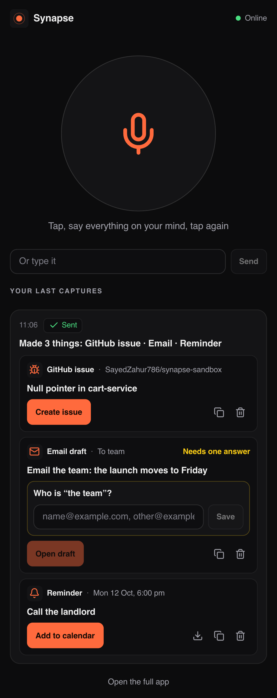
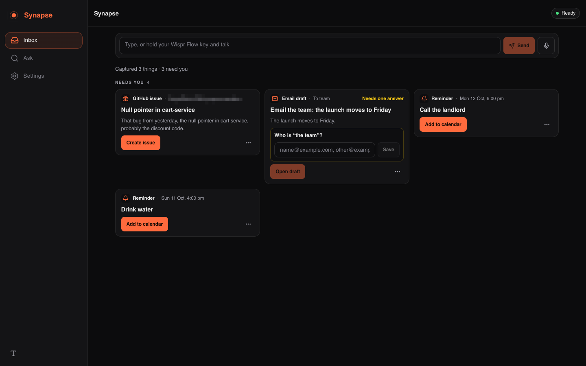

# Synapse

Ramble out loud on your phone or laptop, and Synapse turns it into finished things you can ship: a GitHub issue, an email draft, a reminder, a note. It skips the asides, asks one question when it needs a fact, remembers everything, and answers questions about what you said.

**Website:** https://sayedzahur786.github.io/synapse-site/ · **Your app** runs on your own Mac at a permanent free HTTPS address from **Tailscale Funnel** (`https://<your-mac>.<tailnet>.ts.net`, TLS ends on the Mac). Without Funnel it falls back to an ngrok static domain, then to a temporary Cloudflare URL. Cost: $0.

<!-- 30-second demo GIF goes here (record with docs/DEMO_V1.md). Until then: -->
<p>
  
  &nbsp;
  
</p>

## What you can say, and what you get

One breath can hold several things. Synapse splits them, drops the asides, and gives each one a single primary button.

> “That bug from yesterday… the null pointer in cart service, probably the discount code. Oh, and email the team that the launch moves to Friday. Remind me to call the landlord tomorrow at 6. Wait, was that my phone?”

| You said | You get | One tap |
|---|---|---|
| a bug, a crash, something broken | **GitHub issue** with a summary, what you saw and your suspected cause, filed to the right repo | **Create issue** (for real when GitHub is connected, otherwise a prefilled GitHub page) |
| “email…”, “tell the team…” | **Email draft** in your voice, addressed from your contacts | **Open draft** (Gmail on the laptop, your mail app on the phone) |
| “remind me…” | **Reminder** at the time you said (“tomorrow at 6” is 18:00 your time) | **Add to calendar** (Google Calendar, or an `.ics` with an alarm) |
| an idea, a decision, a note to self | **Note**, saved and searchable | nothing to ship: ask about it later |

If Synapse needs a fact it doesn't have (which repo, Dev's email, what time), the card asks once with tap-able answers, and remembers. Say “actually make it 7” and the reminder moves. Nothing reaches another person without your tap.

## Set up in 5 steps (macOS)

1. **Install.** Node 22.12+ and pnpm 10, then:
   ```bash
   pnpm install
   brew install --cask tailscale # the permanent phone URL (Tailscale Funnel); cloudflared is the fallback:
   brew install cloudflared
   ```
2. **Add your keys.** `cp .env.example .env`, then set:
   ```bash
   SARVAM_API_KEY=...        # speech to text for phone recordings (dashboard.sarvam.ai)
   GROQ_API_KEY=...          # the model that writes the cards (free at console.groq.com/keys)
   LLM_MODE=live
   SYNAPSE_PASSCODE=...      # 12+ characters (a few random words): you type it once on your phone
   ```
   Every key is optional: without them Synapse runs on-device speech and an offline model.
3. **Check it.** `pnpm run doctor` prints ✅ / ⚠️ / ❌ for every piece with a one-line fix.
4. **Turn on Funnel once.** Sign in to Tailscale, run `tailscale funnel 8787` and approve Funnel in the page it opens (signed in as the tailnet's owner; a 404 there means the browser is on another Tailscale account). Then `Ctrl-C`.
5. **Serve it.** `pnpm run serve` builds the app and starts it with the best free tunnel: Tailscale Funnel, else ngrok (`NGROK_DOMAIN`), else a cloudflared quick tunnel (temporary URL, with a warning). It prints the URL and a QR code and saves the URL to `data/public-url.txt`. Force one with `TUNNEL=tailscale|ngrok|cloudflared`.

The laptop app is at `<your URL>/app` (or `http://localhost:8787/app`); `/` is the landing page. The first run walks you through connecting GitHub, adding people and putting the app on your phone. Every step can be skipped.

## Run it as a service (always on)

```bash
pnpm run service:install     # launchd agent: starts at login, restarts within seconds if it stops
pnpm run service:status      # state, public URL, last 20 log lines (~/Library/Logs/synapse/)
pnpm run service:uninstall
```

- The Mac is the server, so it must stay awake on power: **System Settings → Battery → Options → "Prevent automatic sleeping on power adapter when the display is off"**. `pnpm run doctor` checks it.
- If the repo is in Desktop, Documents or Downloads, macOS asks once to let `node` read that folder: click **Allow**.
- While the Mac sleeps, the phone keeps recording: clips wait encrypted on the phone ("Saved on your phone. It will sync when your Mac is awake.") and upload exactly once when it's back.

## Phone setup

1. On your phone open `<your URL>/capture` (scan the QR code `pnpm run serve` prints, or Settings → Put it on your phone).
2. Sign in with your passcode once.
3. Chrome menu → **Add to Home screen**. Tap the icon, tap the big button, talk, tap again. No signal? The recording waits on the phone and goes up when you're back online.

Lost a phone? Settings → Profile & connections → **Log out all devices** (or `pnpm run sessions:revoke`).

## Powered by Wispr Flow

[Wispr Flow](https://wisprflow.ai) is the fastest way to talk to Synapse at your desk. Click the Inbox box (“Type, or hold your Wispr Flow key and talk”), hold your Wispr Flow key and ramble: Wispr types your words in, Enter sends them, and they go through the same pipeline as a phone recording. Synapse can also stream the live microphone straight to the Wispr Flow API (`WISPR_MODE=client` with `WISPR_API_KEY`); see [docs/ENGINEERING.md](docs/ENGINEERING.md).

## Privacy

- Audio is never written to the server's disk. A clip is transcribed in memory and wiped; on the phone, a clip waiting for network is stored encrypted and deleted once it's sent.
- Everything Synapse keeps (thoughts, drafts, your profile, your GitHub token) is encrypted with AES-256-GCM on your Mac. Working memory forgets after 72 hours unless something is worth keeping.
- API keys stay on your Mac. The browser never sees them.
- Remote access needs your passcode. Through the tunnel nothing is trusted by default, and only that one public address may talk to the server.
- With Tailscale Funnel (the default for `pnpm run serve`) the phone's HTTPS is decrypted only on your Mac. The ngrok and Cloudflare fallbacks decrypt it at their edge on the way; the Privacy Center says which one is in use.
- Local-only mode (Settings) keeps everything on the Mac: on-device speech and the offline model. Say “pause memory” or “forget what I said about X” at any time.

## Roadmap

- **Mac quick-capture** with a global hotkey that knows the repo open in your editor (the capture API already accepts `context.repo`).
- **iPhone Shortcut** using the capture-only token from Settings.
- **Sending from Synapse** to Slack and WhatsApp, still behind one tap.
- **A webhook output** so any tool can receive the cards.

## More

[Engineering notes](docs/ENGINEERING.md) · [V1 report](docs/V1_REPORT.md) · [2-minute demo](docs/DEMO_V1.md) · [Product spec](docs/PRD.md) · [Technical spec](docs/TRD.md) · [Privacy whitepaper](docs/PRIVACY_WHITEPAPER.md)

| | |
|---|---|
| `pnpm run serve` | build and serve on :8787 with the public tunnel |
| `pnpm start` | build and serve on :8787, local only |
| `pnpm run service:install` | keep it running (launchd) |
| `pnpm run site:deploy` | publish the landing page to GitHub Pages |
| `pnpm dev` | development: API on :8787, web on :5173 |
| `pnpm run doctor` | what is missing and how to fix it |
| `pnpm test` · `pnpm typecheck` | tests · type checks |
