# Synapse

**Think out loud. Synapse files it.**

A voice-first second brain: it turns a messy spoken ramble into a GitHub issue, an email draft and a reminder, ready to send with one tap.

[](tsconfig.base.json)
[](apps/web/package.json)
[](package.json)
[](apps/server/package.json)
[](apps/server/src/memory/db.ts)
<br>
[](apps/server/src/wispr/sarvam.ts)
[](apps/server/src/llm/groq-client.ts)
[](#wispr-flow-what-is-and-isnt-verified)
<br>
[](#measured-results)
[](#measured-results)
[](#measured-results)
[](docs/hackathon-brief.pdf)

<a href="https://sayedzahur786.github.io/synapse-site/demo/">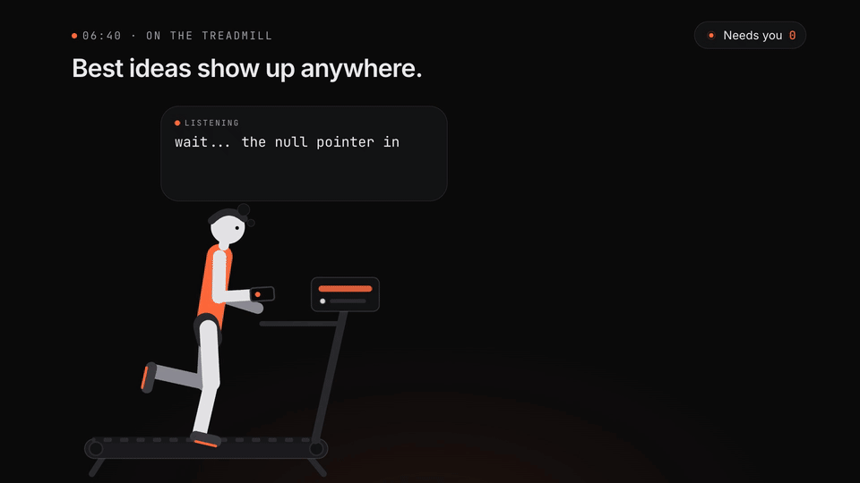</a>

**[▶ Watch the demo](https://sayedzahur786.github.io/synapse-site/demo/)** · [Landing page](https://sayedzahur786.github.io/synapse-site/) · [How it works](#how-it-works) · [Run it locally](#run-it-locally) · [Architecture](docs/ARCHITECTURE.md)

## TL;DR

- **Problem:** your best thoughts arrive when you can't type (running, walking, commuting), several at once and half-formed, and they're gone before you reach a keyboard.
- **What Synapse does:** you talk; it splits one ramble into separate items, drafts each one (an issue for the right repo, an email to the right person, a reminder at the right time), ignores the asides, and waits for one tap before anything is sent.
- **Proof:** 1,174 passing tests; a live run of 10 spoken rambles through real speech-to-text and a real model (8 of 10 fully right on review, median 1.6 s from upload to cards); a real GitHub issue filed end to end. Details in [Measured results](#measured-results).

## The problem

The best ideas show up mid-run. You can't stop to type, so you try to remember, and by the time you're back at a desk the bug's cause, the message for Dev and the thing you promised Mom are gone.

When those thoughts do come out, they come out messy: three intents in one breath, a correction halfway through, an aside about the incline. Existing tools each solve a slice:

| Category | What goes wrong |
|---|---|
| Task apps | Everything lands in one list you sort by hand later. |
| Voice assistants | One command at a time, in the assistant's phrasing. |
| Note apps | One blob of text you have to split and route yourself. |
| Dictation | Works only if you are already in the right app, in the right field. |

## The solution

**The loop: Talk → Sorted → Ship.** Tap the phone, say everything on your mind, tap again. Synapse sorts it into finished drafts. Each draft has one button that hands it to the tool you already use.

**One worked example.** The ramble:

> "That bug from yesterday… the null pointer in cart service, probably the discount code. Oh, and email the team that the launch moves to Friday. Remind me to call the landlord tomorrow at 6. Wait, was that my phone? Actually make it 7."

| Part of the ramble | What it became | One tap |
|---|---|---|
| "the null pointer in cart service, probably the discount code" | **GitHub issue** with a summary, what was observed and the suspected cause, routed to the right repo | **Create issue** (GitHub API) |
| "email the team that the launch moves to Friday" | **Email draft**; asks once "Who is the team?", then remembers | **Open draft** (Gmail or your mail app) |
| "remind me to call the landlord tomorrow at 6 … actually make it 7" | **Reminder**, tomorrow at **7:00 pm**: the correction is applied in place | **Add to calendar** (Google Calendar or `.ics`) |
| "Wait, was that my phone?" | Nothing: an aside, counted and dropped | — |

Verified in [`routes-v1.test.ts`](apps/server/test/routes-v1.test.ts) (issue, email question, reminder, calendar link and `.ics` alarm) and in the [V1 report](docs/V1_REPORT.md) (the same ramble, spoken, through the phone app).

**What makes it different**

- **One ramble, many items, routed by meaning:** each intent becomes its own card in a single model call per capture ([`batch.test.ts`](apps/server/test/batch.test.ts), [`capture-segment.test.ts`](apps/server/test/capture-segment.test.ts)).
- **It asks only when it must, and remembers the answer:** "Who is the team?" is asked once ([`routes-v1.test.ts`](apps/server/test/routes-v1.test.ts)).
- **Draft-first:** nothing reaches another person without your tap ([`integrations.test.ts`](apps/server/test/integrations.test.ts)).
- **Works offline on the phone:** recordings wait encrypted on the phone and sync once, even if the Mac was asleep ([`queue.test.ts`](apps/web/src/capture/queue.test.ts), [`mac-asleep.mjs`](scripts/e2e/mac-asleep.mjs)).
- **Memory you can ask:** "that caching idea from my walk last Tuesday" finds it ([`recall.test.ts`](apps/server/test/recall.test.ts)).

## Demo

**[▶ Watch the full demo (24 s, sound on)](https://sayedzahur786.github.io/synapse-site/demo/)** · files in the repo: [landscape mp4](docs/media/synapse-launch-landscape.mp4) · [vertical mp4 for phones](docs/media/synapse-launch-vertical.mp4)

Music: "Happy Beats / Business Moves Vol. 12" by [ende.app](https://ende.app/en) (royalty-free). The people in the video are illustrations; every Synapse screen and card in it is the real app on demo data.

<table>
  <tr>
    <td width="50%" valign="top">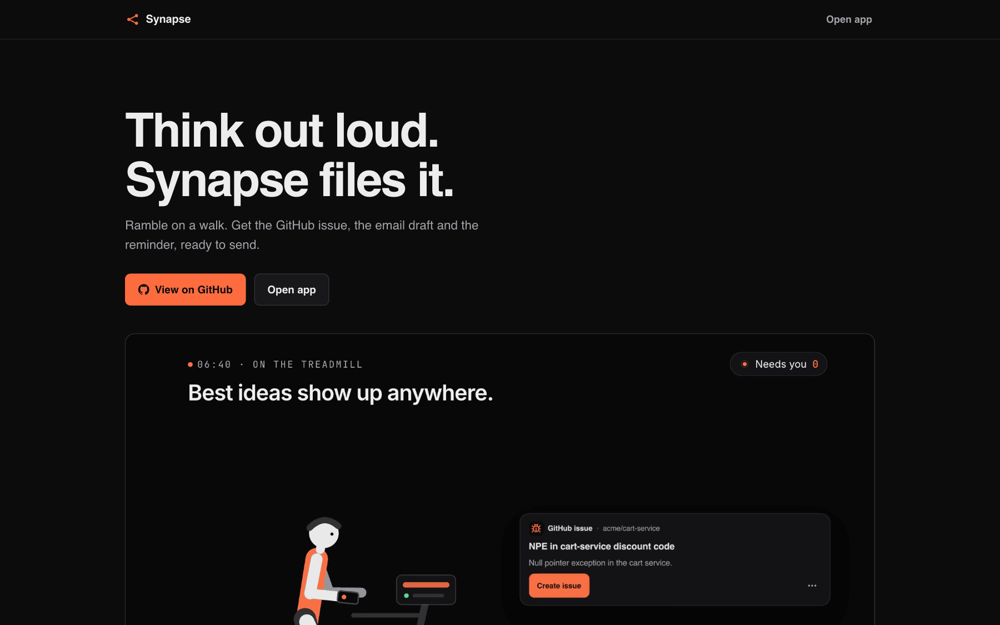<br><sub><b>1.</b> The landing page: the promise in one line, with the launch video below it.</sub></td>
    <td width="50%" valign="top">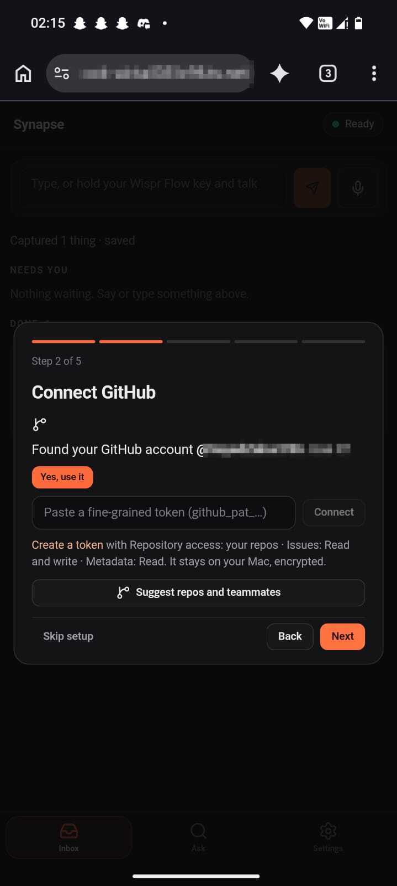<br><sub><b>2.</b> First-run setup on a real phone: Synapse finds your GitHub account; one tap to use it.</sub></td>
  </tr>
  <tr>
    <td valign="top">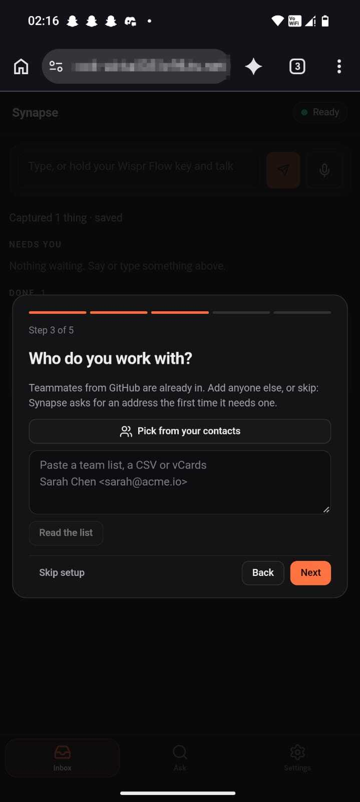<br><sub><b>3.</b> Setup, step 3: add the people you work with, so "email Dev" resolves to an address.</sub></td>
    <td valign="top">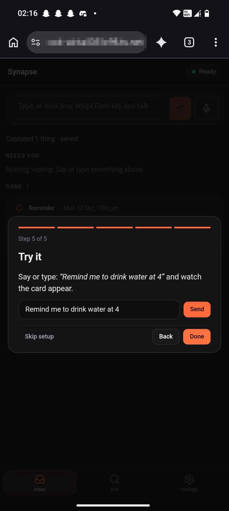<br><sub><b>4.</b> Setup, step 5: say or type a first thought and watch its card appear.</sub></td>
  </tr>
  <tr>
    <td valign="top">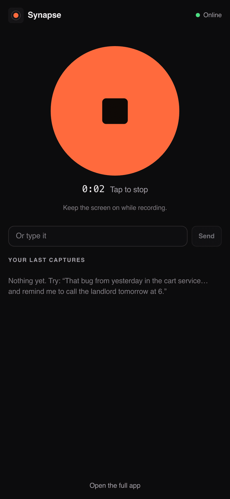<br><sub><b>5.</b> The phone app: tap, talk, tap again. No commands to learn.</sub></td>
    <td valign="top">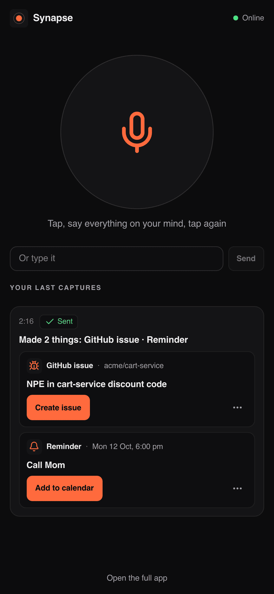<br><sub><b>6.</b> One recording became two cards: a GitHub issue for <code>acme/cart-service</code> and a reminder at 6 pm.</sub></td>
  </tr>
  <tr>
    <td valign="top">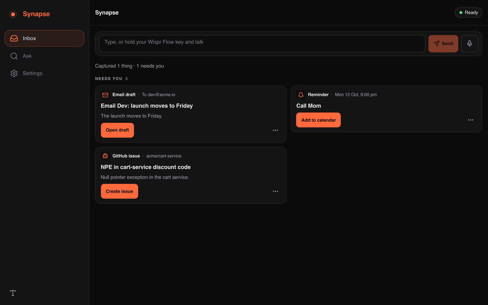<br><sub><b>7.</b> At the laptop, three captures are already drafted under "Needs you", each one tap from done.</sub></td>
    <td valign="top">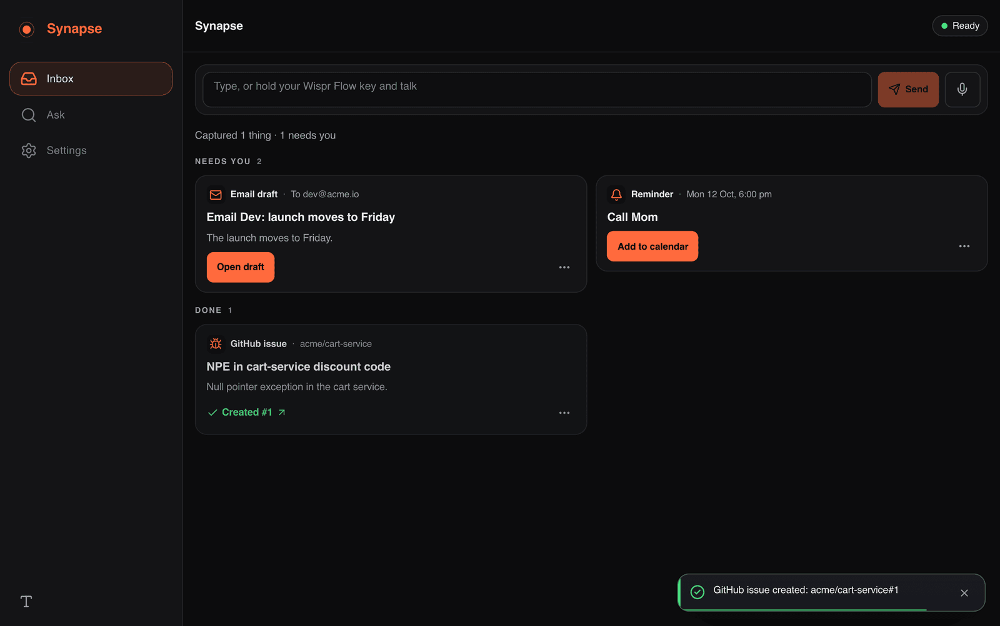<br><sub><b>8.</b> One tap on <b>Create issue</b> files it through the GitHub API: "Created #1".</sub></td>
  </tr>
  <tr>
    <td valign="top">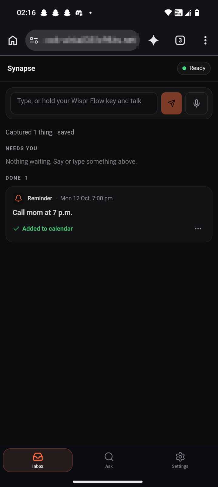<br><sub><b>9.</b> On the phone: a reminder handed to the calendar moves to Done.</sub></td>
    <td valign="top">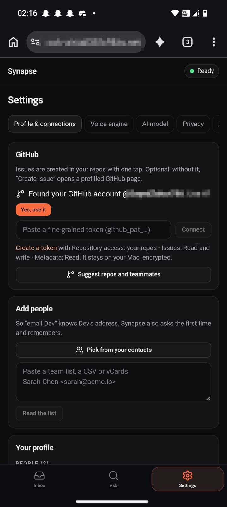<br><sub><b>10.</b> Settings → Profile & connections: GitHub, people and routing in one place.</sub></td>
  </tr>
</table>

<sub>Screens 2–4, 9 and 10 are from the author's phone on the live service (the private address bar is pixelated). Screens 5–8 are demo data (Rio, Sarah, Dev, <code>acme/cart-service</code>) against a protocol-faithful fake GitHub; one issue was also filed against real GitHub in a private sandbox repo ([V1 report](docs/V1_REPORT.md#v11)).</sub>

**What you're seeing, in five steps**

1. You tap the record button on your phone and say what's on your mind, mid-run or mid-lunch.
2. The audio goes to your Mac, which transcribes it with Sarvam and keeps it only in memory.
3. One model call splits the transcript into items and drafts each one; asides are dropped.
4. The cards appear on the phone and the laptop at the same time, over a WebSocket.
5. Back at your desk, everything is already written: one tap files the issue, opens the email draft or adds the reminder to your calendar.

## How it scores against the judging criteria

**General criteria**

| Criterion | What we built | Evidence |
|---|---|---|
| Problem clarity | The thought that arrives when you can't type, lost before a keyboard | [PRD](docs/PRD.md), [research](docs/RESEARCH.md) |
| Solution fit | One ramble → separate, routed, ready-to-send drafts; asides dropped; corrections applied | [`routes-v1.test.ts`](apps/server/test/routes-v1.test.ts), [`batch.test.ts`](apps/server/test/batch.test.ts) |
| Feasibility | Runs today on one Mac, free tiers only, $0 | [V1.1 report](docs/V1_REPORT.md#v11), [setup guide](docs/SETUP.md) |
| Viability | For developers and makers who think while moving; it uses the tools they already have; a hosted mode is the next step | [PRD](docs/PRD.md), [roadmap](#limitations-and-roadmap) |
| Usefulness | Real outputs: a GitHub issue via the API, a prefilled Gmail draft, a Google Calendar event or `.ics` with an alarm | [`routes-v1.test.ts`](apps/server/test/routes-v1.test.ts), screens [6](docs/ss/06-phone-made-two-things.png)–[8](docs/ss/08-laptop-issue-created.png) |
| Speed | Median **1.6 s** from upload to final cards, live, 10 rambles | [Measured results](#measured-results), [V1.1 report](docs/V1_REPORT.md#v11) |
| Relatability | The mid-run story, told in the [demo](https://sayedzahur786.github.io/synapse-site/demo/) | [landscape mp4](docs/media/synapse-launch-landscape.mp4) |
| Technical depth | One-call batch drafting with an offline fallback and a re-draft queue; encrypted memory with forgetting; a seekable launch film built from the real app | [Architecture](docs/ARCHITECTURE.md), [`redraft.test.ts`](apps/server/test/redraft.test.ts), [engineering notes](docs/ENGINEERING.md) |
| Privacy and safety | Audio never written to disk; encryption at rest; redaction before every model call; draft-first; default-deny auth | [Privacy](#privacy-and-security), [whitepaper](docs/PRIVACY_WHITEPAPER.md) |
| Polish | Lighthouse 100 · 100 · 100 · 100 on the live site; one design system across every screen | [Measured results](#measured-results), [screens](#demo) |

**PS4 criteria (Ambient Cognitive Offloading)**

| Criterion (weight) | What we built | Evidence |
|---|---|---|
| Fragment Intelligence (30 %) | Mumbled bug → one issue; self-repair applied ("actually make it 7"); half-formed code; asides ignored | [`pipeline.test.ts`](apps/server/test/pipeline.test.ts) (16 scenarios); held-out intent macro-F1 88.7 % on 63 phrasings ([EVAL](docs/EVAL.md), offline model); [`batch.test.ts`](apps/server/test/batch.test.ts) |
| Proactivity (25 %) | Three schedule-clash mutters → one reschedule suggestion with concrete slots; speaks only at a pause | [`proactive.test.ts`](apps/server/test/proactive.test.ts), [`pipeline.test.ts`](apps/server/test/pipeline.test.ts) |
| Memory Depth (20 %) | Vague, time- and place-anchored recall ("that caching idea from my walk"); a knowledge graph across sessions | [`recall.test.ts`](apps/server/test/recall.test.ts) (Recall@3 10/10 on a small set: 10 queries, 11 thoughts) |
| Privacy Architecture (15 %) | "Pause memory" releases the mic; audio never on disk; crypto-shredded working memory; redaction; local-only mode; hash-chained audit | [`no-audio.test.ts`](apps/server/test/no-audio.test.ts), [`local-only.test.ts`](apps/server/test/local-only.test.ts), [`foundation.test.ts`](apps/server/test/foundation.test.ts), [`egress.test.ts`](apps/web/src/audio/egress.test.ts) |
| Creep Factor (10 %) | Draft-first; "why I kept this"; forget by meaning; no emotion, health or relationship inference | [`integrations.test.ts`](apps/server/test/integrations.test.ts), [`modules.test.ts`](apps/server/test/modules.test.ts), [`no-sensitive-inference.test.ts`](apps/server/test/no-sensitive-inference.test.ts) |

The full mapping, with every scenario, is in [docs/STATUS.md](docs/STATUS.md).

## How it works

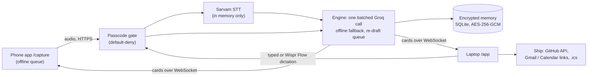

- **Capture.** The phone app records, seals the clip into an encrypted offline queue and uploads it once ([`queue.ts`](apps/web/src/capture/queue.ts)); retries are idempotent by client id.
- **Speech.** Sarvam `saaras:v4` transcribes on the Mac's server; the audio buffer is zero-filled afterwards and never written to disk ([`sarvam.ts`](apps/server/src/wispr/sarvam.ts), [`no-audio.test.ts`](apps/server/test/no-audio.test.ts)).
- **One call per capture.** The redacted transcript goes to Groq once; a validated answer becomes one card per intent. A rate-limit pause is waited out once and invalid JSON is re-asked once, so captures stay at two calls or fewer ([`batch.ts`](apps/server/src/llm/batch.ts), [`batch.test.ts`](apps/server/test/batch.test.ts)).
- **Offline fallback and re-draft.** Without a model, a local segmenter and offline drafter make the cards; when the model is available again, those drafts are upgraded in place ([`redraft.ts`](apps/server/src/cortex/redraft.ts)).
- **Routing.** A profile of repos and people decides where each card goes; a missing fact becomes one question, answered once ([`routes-v1.test.ts`](apps/server/test/routes-v1.test.ts)).
- **Memory.** Every stored field is encrypted; working memory expires after 72 hours with its key destroyed; recall is by meaning ([`foundation.test.ts`](apps/server/test/foundation.test.ts), [`recall.test.ts`](apps/server/test/recall.test.ts)).
- **Ship.** GitHub issues go through the API with a per-card lock (a double tap files one issue); email and calendar open prefilled in your own apps and wait as "Opened" until you tap Done ([`v11-review.test.ts`](apps/server/test/v11-review.test.ts)).
- **Always on.** The Mac serves the app through Tailscale Funnel (TLS ends on the Mac), with ngrok and Cloudflare as fallbacks, and launchd restarts it within seconds ([`tunnels.test.ts`](apps/server/test/tunnels.test.ts), [`service.test.ts`](apps/server/test/service.test.ts)).

Full design: [docs/ARCHITECTURE.md](docs/ARCHITECTURE.md) · [docs/TRD.md](docs/TRD.md).

### Wispr Flow: what is and isn't verified

- **Wispr Flow dictation works in the capture box.** Hold your Wispr Flow key and talk; Wispr types into the box and the text goes through the same pipeline as a phone recording.
- **The Wispr API streaming integration is built and tested** against a protocol-faithful fake of the API ([`wispr.test.ts`](apps/web/src/audio/wispr.test.ts), [`fake-wispr.integration.test.ts`](apps/web/src/audio/fake-wispr.integration.test.ts)). It needs Wispr API access to run live, which we did not have.
- **Sarvam is the live speech engine** for every measured result below.

## Measured results

| What | Result | Source |
|---|---|---|
| Spoken rambles fully right | **9/10** by the automated check, **8/10** on human review (one reminder title wrongly named a person) | [V1.1 report](docs/V1_REPORT.md#v11) |
| Model calls per capture | **≤ 2 on 9/10**; 4 on the one whose audio Sarvam mis-transcribed | [V1.1 report](docs/V1_REPORT.md#v11) |
| Upload → final cards | **1.6 s** median | [V1.1 report](docs/V1_REPORT.md#v11) |
| Phone offline while the Mac sleeps | Clip kept, synced on wake, uploaded **exactly once** (6/6 checks) | [`mac-asleep.mjs`](scripts/e2e/mac-asleep.mjs), [V1.1 report](docs/V1_REPORT.md#v11) |
| Real GitHub issue | Filed end to end through the live server (private sandbox repo) | [V1.1 report](docs/V1_REPORT.md#v11) |
| Tests | **1,174 passing** (web 735, server 439); typecheck clean | `pnpm test`, `pnpm typecheck` |
| Lighthouse, live site and demo page | **100 · 100 · 100 · 100** (performance, accessibility, best practices, SEO) | measured 2026-10-12 with Lighthouse 12.8 |
| Cost | **$0**: Groq and Sarvam free tiers, Tailscale Personal, GitHub Pages | [V1.1 report](docs/V1_REPORT.md#v11) |

**Conditions, honestly:** the 10 rambles were synthetic speech (macOS voices, including Indian English and Hinglish), sent 45 s apart through the public URL to Sarvam `saaras:v4` and Groq `qwen/qwen3.8-27b` on free tiers, on 2026-10-11 (UTC). No real-phone accent study has been done yet.

## Run it locally

**Requirements:** macOS (Linux works without the launchd service), Node 22.12+, pnpm 10, and optionally a Sarvam key, a Groq key, Tailscale and the GitHub CLI.

```bash
git clone https://github.com/Yash-1706/goa-hacks.git synapse && cd synapse
pnpm install
cp .env.example .env          # add SARVAM_API_KEY, GROQ_API_KEY, LLM_MODE=live, SYNAPSE_PASSCODE (12+ characters)
pnpm run doctor               # ✅ / ⚠️ / ❌ for every piece, with a one-line fix each
pnpm test                     # 1,174 tests, no keys or network needed
```

Without keys, Synapse runs fully on its offline model and on-device fallbacks, so everything above works on a fresh clone.

**Serve it to your phone** (permanent free HTTPS through Tailscale Funnel; run `tailscale funnel 8787` once and approve it):

```bash
pnpm run serve                # builds, starts on :8787, prints the public URL and a QR code
pnpm run service:install      # optional: keep it running with launchd (status: pnpm run service:status)
```

**Phone:** open `<your URL>/capture`, sign in with your passcode once, then **Add to Home screen**. The laptop app is at `<your URL>/app` or `http://localhost:8787/app`. The full guide, including sleep settings and troubleshooting, is in [docs/SETUP.md](docs/SETUP.md).

## Privacy and security

- **Audio is never written to disk.** It is held in memory for transcription and zero-filled; on the phone, a clip waiting for network is encrypted with a non-extractable key and deleted once sent ([`no-audio.test.ts`](apps/server/test/no-audio.test.ts), [`queue.test.ts`](apps/web/src/capture/queue.test.ts)).
- **Everything kept is encrypted** with AES-256-GCM per field; working memory is crypto-shredded after 72 hours ([`foundation.test.ts`](apps/server/test/foundation.test.ts)).
- **The model sees redacted text:** emails, phone numbers and key-like strings are masked before every call and restored locally ([`groq-cortex.test.ts`](apps/server/test/groq-cortex.test.ts)).
- **Draft-first:** Synapse never sends anything to another person on its own ([`integrations.test.ts`](apps/server/test/integrations.test.ts)).
- **Default-deny remote access:** every API and WebSocket path needs a passcode session, checked on canonicalised paths; sessions are revocable ("Log out all devices") ([`v11-review.test.ts`](apps/server/test/v11-review.test.ts), [`auth.test.ts`](apps/server/test/auth.test.ts)).
- **Honest transit:** through Tailscale Funnel, TLS ends on your Mac; the ngrok and Cloudflare fallbacks decrypt at their edge, and the Privacy Center says which one is in use ([`transit.test.ts`](apps/web/src/lib/transit.test.ts)).
- **No sensitive inference:** no emotion, health or relationship fields exist in the schemas ([`no-sensitive-inference.test.ts`](apps/server/test/no-sensitive-inference.test.ts)).

More: [docs/PRIVACY_WHITEPAPER.md](docs/PRIVACY_WHITEPAPER.md).

## Tech stack

| Layer | Choice |
|---|---|
| Language | TypeScript (strict, ESM), pnpm workspaces |
| Web | React 19, Vite, Zustand, an installable PWA for the phone |
| Server | Node 22+, Fastify 5, WebSocket, `node:sqlite` |
| Speech | Sarvam `saaras:v4` (live); Wispr Flow (dictation; API client built); on-device Whisper fallback |
| Model | Groq `qwen/qwen3.8-27b` (one call per capture); offline drafter as fallback |
| Hosting | Your Mac: Tailscale Funnel → ngrok → Cloudflare quick tunnel; launchd |
| Tests | Vitest (1,174), Playwright end-to-end checks, Lighthouse |
| Launch video | /brag + Hyperframes, rendered from the real app |

## Limitations and roadmap

**Limitations**

- The Mac is the server, so it must be awake; when it sleeps, the phone keeps recordings and syncs later.
- Free-tier rate limits cap throughput at roughly two captures a minute; captures wait their turn rather than fail.
- No real-phone accent study yet; the measured run used synthetic voices.
- The Wispr Flow API integration has not been verified live (no API access); it is tested against a faithful fake.

**Roadmap**

- Mac quick-capture with a global hotkey that knows the repo open in your editor.
- An iPhone Shortcut using the capture-only token.
- Sending to Slack and WhatsApp, still behind one tap; webhook outputs for any tool.
- A hosted mode, so the phone works without your Mac.

## Project docs

| Doc | What it covers |
|---|---|
| [PRD](docs/PRD.md) · [TRD](docs/TRD.md) | Product and technical specs |
| [Architecture](docs/ARCHITECTURE.md) | The system as built |
| [Privacy whitepaper](docs/PRIVACY_WHITEPAPER.md) | What leaves the device, retention, threat model |
| [Failure modes](docs/FAILURE_MODES.md) | What breaks, and what happens then |
| [Eval](docs/EVAL.md) · [Latency](docs/LATENCY.md) | Accuracy and speed measurements |
| [V1 report](docs/V1_REPORT.md) | The V1 and V1.1 builds and their live verification |
| [Engineering notes](docs/ENGINEERING.md) · [Setup guide](docs/SETUP.md) | Internals; running it day to day |
| [All docs](docs/README.md) | The full index |

## Credits

- **Contributors:** Yash Gaikwad ([@Yash-1706](https://github.com/Yash-1706)): original build and UI. Sayed Zahur ([@SayedZahur786](https://github.com/SayedZahur786)): V1 and V1.1 (phone capture, outputs, hosting, launch). The 21 earliest commits were authored under an automated build identity ("Synapse Build").
- Built for the **WhisperFlow Hackathon 2026**, Problem Statement 4: Ambient Cognitive Offloading ([brief](docs/hackathon-brief.pdf)).
- Speech by [Sarvam](https://www.sarvam.ai), drafting by [Groq](https://groq.com), dictation by [Wispr Flow](https://wisprflow.ai).
- Launch video made with [/brag](https://github.com/latent-spaces/brag) (latent-spaces) and Hyperframes.
- Music: "Happy Beats / Business Moves Vol. 12" by [ende.app](https://ende.app/en), royalty-free.
