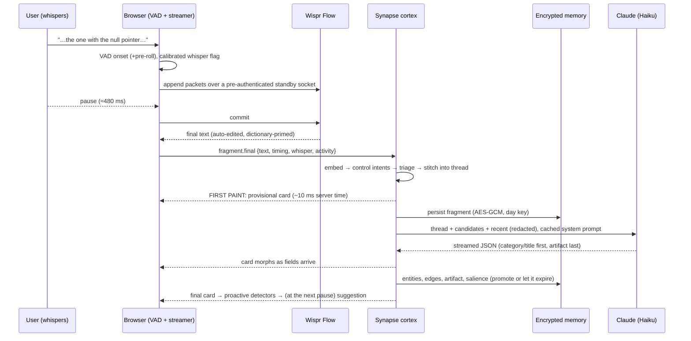

# Synapse: architecture

*Deliverable: architecture diagram showing how Wispr Flow's API integrates with the agent, the context engine and the memory.*
Problem Statement 4 · Ambient Cognitive Offloading. Companion docs: [PRD](./PRD.md) · [TRD](./TRD.md) · [Privacy](./PRIVACY_WHITEPAPER.md) · [Failure modes](./FAILURE_MODES.md) · [Latency](./LATENCY.md) · [Eval](./EVAL.md).

## 1. The system in one picture

```mermaid
flowchart LR
  subgraph DEV["Device: desk browser / phone PWA (audio never leaves here except to Wispr)"]
    MIC["Microphone"] --> GATE["Energy pre-gate"] --> VAD["Silero VAD v5 (on-device, whisper-tuned)"]
    VAD -->|"speech frames + 320 ms pre-roll"| STREAM["Wispr streamer<br/>standby socket, 1 session per utterance"]
    STREAM -->|"final text"| KILL["Local kill switch<br/>'pause memory' → mic released"]
    KILL -->|"fragment.final"| WS["WebSocket to Synapse"]
    VAD -->|"speech.state"| WS
    SENS["Activity (motion) · battery · wake lock"] --> WS
    UI["Desk / Pocket UI<br/>cards morph live"] <--> WS
  end

  STREAM <==>|"wss client_ws · 16 kHz int16 PCM base64<br/>JWT minted by our server"| WISPR[("Wispr Flow API<br/>auto-edit · 100+ languages · dictionary_context")]

  subgraph BRAIN["Synapse server (the brain, runs on the laptop)"]
    HUB["Gateway: WS hub + REST<br/>pairing · clock sync · speech-aware quiet"]
    HUB --> ENG
    subgraph ENG["Cortex engine"]
      direction TB
      E1["embed (local MiniLM 384-d)"] --> E2["control intents<br/>pause / forget"] --> E3["local triage<br/>kNN + cues → FIRST PAINT"]
      E3 --> E4["thought stitcher<br/>(pauses are thinking)"] --> E5["reference resolver<br/>'that thing' → candidates"]
      E5 --> E6["Claude: stream + strict schema<br/>or mock cortex"] --> E7["apply: split / merge / correct<br/>entities · edges · artifact · salience"]
    end
    ENG <--> MEM[("Encrypted memory<br/>SQLite + AES-256-GCM<br/>working 72 h · long-term<br/>per-day keys, crypto-shredding")]
    MEM --- KG["Knowledge graph<br/>sessions · thoughts · entities · decisions"]
    ENG --> PRO["Prefrontal: proactive engine<br/>recurring concern · open questions · echo<br/>contradiction · repeated pattern"]
    PRO --> DELIV["Delivery scheduler<br/>only at pauses · value-ranked · rate-limited"]
    DELIV --> HUB
    REC["Recall: constraints → hybrid search<br/>→ cited streamed answer"] <--> MEM
    SLEEP["Sleep cycle: merge entities,<br/>link sessions, label, prune dictionary"] <--> MEM
    PRIV["Guardian: pause · forget · purge<br/>hash-chained audit"] <--> MEM
    OUT["Outbox + autonomy ladder<br/>GitHub · Jira · calendar · mailto"]
    WTOK["Wispr service: mint tokens,<br/>warm-up, context"]
  end

  WS <--> HUB
  WTOK -->|"generate_access_token (org key never leaves)"| WISPR
  MEM -->|"self-healing dictionary + last 6 fragments"| WTOK
  WTOK -->|"wispr.context / wispr.token"| WS
  E6 <-->|"redacted text only"| CLAUDE[("Claude API<br/>Haiku 4.5 hot path · Opus 5.5 recall/brief")]
  REC <-->|"redacted"| CLAUDE
  OUT --> GH[("GitHub / Jira")]
```

**Where Wispr Flow sits:** it is the *only* component that ever receives audio, and it receives it directly from the browser. Synapse turns Wispr's polished text into structure. In return Synapse feeds Wispr what it learns (self-healing dictionary + the last few fragments as `conversation` context) so the next utterance is transcribed better.

## 2. One fragment, end to end

Timing, measured per stage, is in [LATENCY.md](./LATENCY.md).

## 3. Components and where they live

| Concern | Module | Notes |
|---|---|---|
| Capture, VAD, Wispr streaming, local kill switch | `apps/web/src/audio/*` | one Wispr WS session per utterance + standby socket; REST fallback; zero-fill buffers |
| Sensors (activity, battery, wake lock) | `apps/web/src/sensors/*` | foreground-only capture (iOS/Android limits) |
| UI (Desk, Pocket, Graph, Recall, Privacy, Lab, Outbox) | `apps/web/src/*` | cards morph with `motion`; reasoning trail per card |
| Protocol and schemas | `packages/shared/src/*` | one zod source of truth for the wire and for the model's structured output |
| Gateway | `apps/server/src/gateway/*` | validated messages, pairing/trust, clock offset, speech-aware quiet |
| Control intents, triage, redaction | `apps/server/src/gate/*` | pause/forget never reach storage; redaction before every cloud call |
| Cortex | `apps/server/src/cortex/*` | stitcher, resolver, prompts, mock cortex, salience, engine |
| LLM clients | `apps/server/src/llm/*` | strict structured-output schema, partial-JSON streaming, timeouts, degradation |
| Memory | `apps/server/src/memory/*` | vault (crypto), SQLite, indexes, store (cascade delete, TTL sweep), graph |
| Recall | `apps/server/src/recall/*` | temporal parsing, hybrid search, relaxation, two-phase answer |
| Proactivity | `apps/server/src/proactive/*` | detectors, delivery scheduler, autonomy policy, feedback adaptation |
| Sleep cycle | `apps/server/src/consolidate/*` | entity merge, cross-session linking, session labels |
| Privacy | `apps/server/src/privacy/*` | pause/forget/purge/export, hash-chained audit |
| Integrations | `apps/server/src/integrations/*` | GitHub/Jira (real or simulated), local calendar + `.ics`, mailto |
| Metrics | `apps/server/src/metrics/*` | per-stage latency with device clock offsets; energy model |

## 4. Memory model

| Tier | Contents | Where | Lifetime |
|---|---|---|---|
| Sensory | PCM audio | browser RAM only | until Wispr's final text arrives (seconds), then zero-filled |
| Working | fragments, thoughts, journal, open loops, embeddings | SQLite, sealed with a **per-day key** | **72 h**, then rows deleted *and* the day key destroyed (crypto-shredding) |
| Long-term | promoted thoughts, entities, decisions, artifacts, edges, dictionary | SQLite, sealed with the long-term key | until you delete it |

**Promotion is implicit, by how you speak:** explicit "note to self", actionability, repetition (the same thought again), anchoring to a known entity, deadlines, emphasis, being recalled later, or accepting its card. Each contribution is recorded, so every kept thing can say *why it was kept*.

## 5. Why it is shaped this way (decisions worth defending)

- **Two-speed cognition.** A local classifier paints a provisional card in ~10 ms; the model fills in the structured artifact and the card morphs as tokens stream. This is how "fragment → ticket" feels instant without pretending the model is.
- **Short segments + a stitcher.** Wispr auto-edits inside an utterance ("6pm, actually 7pm" → "7pm"), which would erase the repair trail. Segmenting at ~480 ms puts repairs *across* fragments where Synapse sees both sides, and the stitcher treats pauses as thinking, not topic change.
- **Draft-first autonomy ladder.** L0 observe · L1 draft · L2 stage (default) · L3 execute only private + reversible + self-only actions at high confidence. Nothing is ever sent to another human.
- **Retrieval over verbatim + gist.** Research on lifelog memory shows simple retrieval over verbatim chunks beats LLM-extracted facts, so each thought is scored by its best verbatim fragment *and* its gist; the graph expands and explains, it does not replace retrieval.
- **The strict output schema is ours.** The SDK's JSON-schema helper moves `enum`/`const` into descriptions; we build the schema ourselves so `category` and the artifact `kind` are genuinely constrained, with the SDK schema as an automatic fallback if the API ever rejects ours.
- **Degrade, never stall.** Slow or failed model → the local cortex answers (badged "mock"/"degraded"); Wispr failure → REST fallback → "failed" tick; no embedding model → lexical hash embeddings.

## 6. Deviations from the TRD (the code is the authority)

| Topic | TRD said | Built | Why |
|---|---|---|---|
| Similarity thresholds | 0.70–0.82 | recalibrated in `thresholds.ts` (e.g. echo 0.5, repeat 0.7) | measured MiniLM cosine scale: paraphrase 0.7–0.95, same-topic 0.45–0.65, unrelated ≈ 0 |
| Stitcher score | additive constants | base by gap (0.55/0.40/0.20) + similarity + cues; corrections of a closed thread never rejoin it | "scratch that" was being merged into the thought it retracts |
| Structured output | `zodOutputFormat` | own strict schema + SDK fallback | SDK drops `enum`/`const` |
| Thought versions table | stored | not built | not needed for the demo |
| Local pause accelerator (KWS) | P1 | not built; pause is on Wispr's final text (phrase match + server semantic backstop) | scope; see FAILURE_MODES |
| Local STT fallback | P1 | not built | scope |
