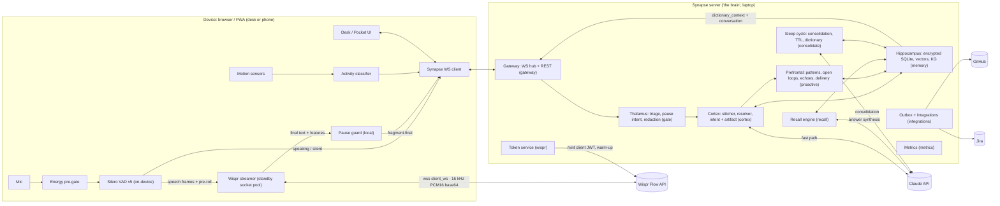

# Synapse — Technical Requirements Document (TRD)

> Companion to [`PRD.md`](./PRD.md) · PS4 *Ambient Cognitive Offloading* · WhisperFlow Hackathon 2026
> Status: v1.0 spec (build-ready), **now implemented**. Date: 2026-10-06
> Audience: the build agent and the team. **Read PRD §6 (requirements) and this doc's §18 (build order) before writing code.**
>
> **As-built note:** this is the *design*. Where the implementation deliberately differs (recalibrated similarity thresholds in `apps/server/src/thresholds.ts`, the stitcher scoring, our own strict structured-output schema, features cut for time) the differences are listed in [`ARCHITECTURE.md` §6](./ARCHITECTURE.md). The code is the authority; numbers quoted here as thresholds are *design* values.

---

## 1. Constraints and environment

| Item | Value |
|---|---|
| Dev machine | Windows 11, PowerShell + Git Bash, **Node v25.2.1**, pnpm 10.28, Bun 1.4, Python 3.14, Docker 29, Git 2.52, `gh` CLI. **No Ollama, no `ant` CLI.** |
| API keys present now | **None** (`ANTHROPIC_API_KEY`, Wispr key, GitHub token are all unset). Everything must run in **mock mode** first. Keys arrive via `.env`. |
| Wispr Flow API access | Exclusive access through the Developer Platform (`https://platform.wisprflow.ai` → API Keys). Hackathon organizers should provide keys. |
| Time box | 24 h, team of 2–4. Build in strict priority order (§18). |
| Language | **TypeScript everywhere** (server + web + shared). Node runs TS via `tsx` in dev. |
| Repo root | `D:\goa-hack` (not yet a git repo → `git init` at M0). |

**Hard rules (do not violate):**
1. Audio is **never** written to disk and **never** sent to the Synapse server in the default (`client`) mode.
2. API keys live only on the server (`.env`). The browser only ever gets **short-lived Wispr client JWTs**.
3. Nothing is sent to another human (email, Slack, external calendar invite) without explicit consent. GitHub/Jira creation obeys the autonomy policy (§9.6).
4. All persisted user text and embeddings are encrypted (§10.3).
5. Before writing any Claude API code, **load the `claude-api` skill** and follow its TypeScript docs (`typescript/claude-api/README.md`, `tool-use.md` → Structured Outputs, `streaming.md`). Use only exact model IDs from §6.5.

---

## 2. Architecture overview

Brain-metaphor module names are used in the pitch. Code modules use the plain names in parentheses.



**Key architectural decisions**
| # | Decision | Why |
|---|---|---|
| AD-1 | Browser streams audio **directly** to Wispr (`client_ws` + client JWT); the server receives only text. | Wispr recommends it for the lowest latency, and audio never touches our infra (privacy). |
| AD-2 | **One Wispr WS session per utterance**, plus a pre-authenticated **standby socket**. | The Wispr WS closes after the final transcription. The standby removes connect + auth from the critical path. |
| AD-3 | **Aggressive VAD segmentation (~500 ms) + server-side thought stitching.** | Lower end-of-speech latency. Self-repairs span fragments, so Synapse sees both sides even though Wispr auto-edits within an utterance. |
| AD-4 | **Two-speed cognition:** local triage (≈20 ms) paints a provisional card instantly, and the fast LLM fills the structured artifact (≈0.6–1.0 s). | Meets the <1 s fragment-to-action target with honest stage reporting. |
| AD-5 | **SQLite + app-level AES-256-GCM** with per-day keys for working memory (crypto-shredding), and in-RAM vector and lexical indexes. | Zero plaintext at rest, provable deletion, no infra to run. Brute-force cosine over <20k vectors takes milliseconds. |
| AD-6 | **Local embeddings** (transformers.js, ONNX, CPU). | Retrieval works offline and is private. No embedding API dependency. |
| AD-7 | **Mock modes** for Wispr and the LLM. | Keys are absent today. The demo must survive outages. Evals and replays need determinism. |

---

## 3. Repository layout

```
D:\goa-hack
├─ package.json                 # pnpm workspaces root; scripts: dev, build, test, eval, bench, seed, replay
├─ pnpm-workspace.yaml          # apps/*, packages/*
├─ tsconfig.base.json
├─ .env.example                 # all variables of §16, with comments
├─ .gitignore                   # node_modules, data/, .env, *.db, certs/
├─ CLAUDE.md                    # build-agent instructions (kept short; points here)
├─ apps/
│  ├─ server/                   # Node 25 + TypeScript, Fastify 5 + @fastify/websocket
│  │  └─ src/
│  │     ├─ index.ts            # bootstrap: config → db → indexes → services → http/ws
│  │     ├─ config.ts           # zod-validated env
│  │     ├─ bus.ts              # typed in-process event bus (EventEmitter wrapper)
│  │     ├─ gateway/            # ws hub (devices, broadcast), REST routes, clock sync
│  │     ├─ wispr/              # token minting, warm-up, context builder, proxy-mode client
│  │     ├─ gate/               # triage (kNN exemplars), pause-intent matcher, redaction
│  │     ├─ cortex/             # stitcher, resolver, intent engine, prompts/, schemas/, enrich
│  │     ├─ memory/             # db, migrations, crypto, repos, embeddings, vector+lexical index,
│  │     │                      #   kg, salience, ttl, dictionary
│  │     ├─ recall/             # query parser, retriever, synthesizer
│  │     ├─ proactive/          # detectors/, scheduler (delivery timing), autonomy policy, feedback
│  │     ├─ consolidate/        # sleep cycle: entity merge, linking, summaries, dictionary
│  │     ├─ privacy/            # pause controller, purge, forget, audit chain, export
│  │     ├─ integrations/       # github, jira, calendar (local model + ics), email (mailto)
│  │     ├─ llm/                # anthropic client, model roles, retries/timeouts, mock LLM
│  │     └─ metrics/            # latency recorder, battery samples, report generator
│  └─ web/                      # React 19 + Vite + TS + Tailwind v4 + zustand + motion; PWA
│     └─ src/
│        ├─ audio/              # mic, pre-gate, vad, ring buffer, pcm16 encode, wispr client, standby
│        ├─ sensors/            # motion activity classifier, battery, wake lock
│        ├─ net/                # synapse ws client (reconnect, clock sync), rest client
│        ├─ state/              # zustand stores (stream, thoughts, suggestions, privacy, metrics)
│        ├─ screens/            # Desk, Pocket, Graph, Recall, Privacy, Lab, Outbox
│        └─ components/         # Orb, FragmentStream, ThoughtCard/*, SynapseRail, TrailDrawer,
│                               #   LatencyBadge, GraphView, TimelineScrubber, BatteryLab
├─ packages/
│  └─ shared/                   # protocol + domain zod schemas and TS types (single source of truth)
├─ eval/                        # golden corpora (jsonl) + runner
├─ scripts/                     # replay/*.json scripted rambles, seed.ts, bench.ts
├─ data/                        # (gitignored) synapse.db, keyfile, calendar.json
└─ docs/                        # PRD, TRD, ARCHITECTURE, PRIVACY_WHITEPAPER, FAILURE_MODES,
                                #   LATENCY (generated), EVAL (generated), DEMO_SCRIPT, PITCH
```

---

## 4. Technology stack

| Concern | Choice | Notes |
|---|---|---|
| Server runtime | Node 25 + `tsx` (dev) | ESM throughout. |
| HTTP/WS | Fastify 5 + `@fastify/websocket` | One WS endpoint `/ws`, REST under `/api`. |
| Validation | `zod` | Shared schemas in `packages/shared`. Use the zod major version that `@anthropic-ai/sdk/helpers/zod` supports (check the skill doc). |
| LLM | `@anthropic-ai/sdk` | Structured outputs via `client.messages.parse()` + `zodOutputFormat()`; streaming for recall. See §6.5. |
| DB | SQLite (see §10.1 for the binding) | WAL mode, `secure_delete=ON`. |
| Embeddings | `@huggingface/transformers` (ONNX) in Node | Model in §4.1 / §8.8. Loaded once at boot and warmed. |
| Vector index | In-memory Float32 matrix, brute-force cosine | Rebuilt from decrypted rows at boot. |
| Lexical index | `minisearch` | In-memory BM25-style index, never persisted. |
| Temporal parsing | `chrono-node` | "last Tuesday", "yesterday afternoon", "3 days ago". |
| IDs | `ulid` (internal) + short display codes (`T-123`, `E-12`, `A-7`) | Display codes are used in citations. |
| Web | React 19 + Vite + TypeScript + Tailwind v4 + `zustand` + `motion` + `lucide-react` | Dark, calm theme. |
| VAD | `@ricky0123/vad-web` 0.0.31 (Silero v5) + `onnxruntime-web` 1.30.0 + `vite-plugin-static-copy` | §5.2, §4.1. |
| Graph viz | `react-force-graph-2d` | §13.4. |
| PWA | `vite-plugin-pwa` | Pocket mode installable. |
| Tests | `vitest` | Unit + pipeline tests. Eval runner is separate. |
| GitHub / Jira | plain `fetch` | No SDK dependency. Fine-grained PAT. `gh auth token` can supply it. |

*(Section §4.1 below records the version and compatibility findings from the research pass.)*

### 4.1 Compatibility findings (verified 2026-10-06 against npm/GitHub; items marked ⚠️ are unverified)

| Area | Decision | Details and gotchas |
|---|---|---|
| Node | Keep **Node 25.2.1** (works). ⚠️ Node 25 reached end-of-life on 2026-06-01 (it is not an LTS line). Prefer Node 24 LTS or Node 26 (LTS from 2026-10-28) for anything long-lived. | All native deps below use N-API, so switching versions does not break them. |
| pnpm | pnpm 10.28 with `onlyBuiltDependencies` allow-list in `pnpm-workspace.yaml` | pnpm 10 skips dependency install scripts by default. onnxruntime-node's postinstall downloads nothing on win32-x64, so skipping it is harmless. |
| SQLite | **`node:sqlite`** (`DatabaseSync`), SQLite 3.50.4 | Verified working here. "Stability 1.1" on 25.2.1 → prints an ExperimentalWarning (suppressed in `silence.ts`). Blobs: pass `Uint8Array`/`Buffer`, read back `Uint8Array`. `allowExtension` works. Wrapped by `memory/db.ts` so it can be swapped for `better-sqlite3` 13 (N-API, prebuilt `win32-x64`, no install script). |
| Vector search | **Brute-force cosine in memory** | Measured here: 20k × 384-d top-10 ≈ **11 ms**; 5k ≈ 3 ms; loading 20k 384-d blobs ≈ 84 ms. `sqlite-vec` is not used (Windows load failures reported; ⚠️ unverified). |
| Embeddings | **`@huggingface/transformers` 4.3.0** (`onnxruntime-node` 1.30.0), CPU, `dtype:"q8"`, mean pooling, `normalize:true` | **Default model `Xenova/all-MiniLM-L6-v2`** (384-d, 23 MB, ~3–6 ms/sentence). Reason: its cosine similarities are well spread (unrelated ≈ 0–0.2, related ≈ 0.5–0.8), so the thresholds in this TRD hold. `Xenova/multilingual-e5-small` (118 MB, ~100 languages) is supported through `EMBED_MODEL`, but e5 similarities are compressed into ~0.7–1.0, so `embeddings.ts` applies a per-model calibration (`cal(c) = (c − 0.72)/0.28`) and uses the `"query: "` / `"passage: "` prefixes. ⚠️ Windows System32 has an old `onnxruntime.dll`. If you see "requested API version … only [1, 17]", the wrong DLL was loaded. Stay on CPU, run under Node (not Bun). First run downloads the model from Hugging Face. Pre-download before the demo; cache in `data/models`. `EMBEDDINGS=hash` is a deterministic offline fallback (hashed char n-grams, 384-d) used in tests. |
| Lexical | `minisearch` 7.2 (in-memory) | FTS5 cannot search ciphertext, so the keyword index is built in RAM after decrypting. |
| Encryption | Field-level **AES-256-GCM** via `node:crypto`, 12-byte random IV, AAD = `table\|id\|column` | Measured: 20k × 1.5 KB values: encrypt 436 ms, decrypt 189 ms (decrypted once at boot). Whole-file alternative `better-sqlite3-multiple-ciphers` is not used. `PRAGMA secure_delete=ON`. |
| Key storage | Passphrase (scrypt) → else OS credential store via **`@napi-rs/keyring`** (optional dependency, prebuilt, no install script) → else keyfile in `DATA_DIR` with a warning in the Privacy Center | `keytar` is archived. Do not use it. |
| Temporal parsing | **`chrono-node` 2.10.2** | Returns a point, not a range. Build ranges with `isCertain()` and part-of-day rules (morning 05–12, afternoon 12–17, evening 17–22, night 22–05). Pass `{instant, timezone}`. Handles "last Tuesday", "yesterday afternoon", "three days ago". English only, so a Hindi phrase falls back to the LLM's `recall` fields. |
| LLM SDK | **`@anthropic-ai/sdk` 0.131.0**, peer `zod ^3.25 \|\| ^4`, use **zod 4.6** | `client.messages.parse({…, output_config:{format: zodOutputFormat(Schema)}})` → `parsed_output`. Structured outputs are supported on Haiku 4.5, Sonnet 5.5 and Opus 5.5. |
| Web build | Vite 8.3 + `@vitejs/plugin-react` 6 + Tailwind 4.3 (`@tailwindcss/vite`) + React 19.3 | `vite-plugin-pwa` 2.0.0 was released 2026-10-03. If it misbehaves, pin 1.3.0. |
| VAD | **`@ricky0123/vad-web` 0.0.31** | **Must set `model:"v5"` explicitly** (default is `"legacy"`; ≥ 0.0.31 fixes Silero v5's missing 64-sample context, which hurt quiet speech). v5 frames = 512 samples (32 ms @ 16 kHz). Defaults: pos 0.3, neg 0.25, redemption 1400 ms, preSpeechPad 800 ms, minSpeech 400 ms. `onFrameProcessed(probs, frame)` gives a 16 kHz `Float32Array` we reuse for Wispr packets. Expect ~1–3 ms/frame in WASM (⚠️ estimate). Run exactly one instance and call `destroy()` (open iOS WASM-OOM issue #134). |
| VAD assets | `vite-plugin-static-copy` 4.1 copies only: `vad.worklet.bundle.min.js`, `silero_vad_v5.onnx` (2.2 MB), `ort-wasm-simd-threaded.wasm` (13.6 MB) and `.mjs` into `/vad/` | Add **`onnxruntime-web@1.30.0` as a direct dependency** (pnpm hides transitive deps, and the wasm must match the runtime). `MicVAD.new({model:"v5", baseAssetPath:"/vad/", onnxWASMBasePath:"/vad/"})`. Use forward slashes in globs on Windows. Workbox won't precache files > 2 MiB by default, so raise `maximumFileSizeToCacheInBytes` or runtime-cache. transformers.js loads its own ORT wasm from jsDelivr by default. If it is used in the browser, set `env.backends.onnx.wasm.wasmPaths` to a separate local folder. |
| Graph viz | **`react-force-graph-2d` 1.29.2** (canvas) | 500 nodes is easy. Use `nodeCanvasObject`, `linkDirectionalParticles`, `onEngineStop → zoomToFit`. |
| Mobile capture | **Foreground-only** | iOS mutes the mic when the page is backgrounded or the screen locks (WebKit bug 226620, no web workaround). Android Chrome similar (⚠️ one report: ~5 s after backgrounding). Design: Screen Wake Lock + black Pocket screen + re-request the lock on `visibilitychange`. |
| Battery API | `navigator.getBattery()` only in Chromium (Chrome/Edge/Samsung/Android) | Not in Safari/iOS/Firefox. Feature-detect and offer a manual "Saver" toggle. Compute Pressure API is desktop Chrome only. |
| Kill phrase | **Primary: pause intent on the Wispr final** (client-side match, ≤ ~1 s). **P1 accelerator: local Moonshine-tiny via transformers.js in a Web Worker** on the last ~3 s of short VAD segments, so the phrase audio need not reach Wispr. | Web Speech API is rejected (Chrome sends audio to Google). Porcupine needs an online AccessKey and has no personal tier. `vosk-browser` is unmaintained and weak on whispers. ⚠️ No engine is reliable on true whispers, so rehearse in the demo room. A big Pause button is always visible as the fallback. |
| GitHub | plain `fetch` → `POST /repos/{owner}/{repo}/issues`, header `X-GitHub-Api-Version: 2022-11-28` | Fine-grained PAT with "Issues: read/write". Labels and assignees are silently dropped when the token's user lacks push access. No extra dependency. |
| Jira | plain `fetch`, Basic auth (`email:token`) → `POST /rest/api/3/issue` with an ADF `description` | `{type:"doc",version:1,content:[{type:"paragraph",content:[{type:"text",text}]}]}`. Scoped tokens must use `https://api.atlassian.com/ex/jira/{cloudId}`. |
| Calendar / email | Local calendar model + hand-written `.ics` · `mailto:` links (≤ ~2000 chars) | Google Calendar (OAuth "Testing" mode refresh tokens expire after 7 days) and Gmail drafts (`gmail.compose` is a restricted scope) are P2 behind a flag. |

---

## 5. Capture pipeline ("Ear"), web client

### 5.1 Audio graph
```
getUserMedia({audio:{echoCancellation:true, noiseSuppression:true, autoGainControl:true, channelCount:1}})
  → AudioContext → VAD (Silero v5, 16 kHz frames of 512 samples = 32 ms)
       ├─ onFrameProcessed(probs, frame)  → ring buffer (last 16 frames ≈ 512 ms) + RMS meter
       ├─ onSpeechStart()                 → claim standby Wispr socket; flush pre-roll; stream
       ├─ onSpeechEnd(audio)              → commit; keep PCM until final (for REST fallback)
       └─ onVADMisfire()                  → abort socket WITHOUT commit; drop audio
```
- `autoGainControl` helps whispers. If AGC over-amplifies noise in the venue, expose a toggle.
- **Noise-floor calibration** at start (2 s): `noiseRms = p50(frame RMS)`. Whisper flag: `utteranceMeanRms < max(noiseRms × 3, WHISPER_RMS_ABS)` while VAD reports speech. Recalibrate when the device changes or on demand.

### 5.2 VAD configuration (whisper-sensitive, low-latency)
| Param | Value | Rationale |
|---|---|---|
| model | `v5` | Better on quiet speech. |
| positiveSpeechThreshold | **0.35** (default 0.5) | Catches whispers and mumbles. Raise to 0.45 in Eco mode or noisy rooms. |
| negativeSpeechThreshold | **0.20** | Hysteresis. |
| redemption (silence before end) | **≈ 480 ms** (15 frames) | Aggressive segmentation (AD-3). Configurable 300–900 ms. |
| pre-speech pad | **≈ 320 ms** (10 frames) | Don't clip the first syllable. |
| min speech | **≈ 160 ms** (5 frames) | Shorter → misfire. "Pause memory" (~700 ms) is safely above. |

> Option names differ across `vad-web` versions (frame-based vs `…Ms`). Use the installed version's API (§4.1).

### 5.3 Packetization for Wispr
- Frames are Float32 at 16 kHz → clamp → Int16 little-endian (`s<0 ? s*0x8000 : s*0x7FFF`) → **raw PCM bytes, no RIFF header** → base64.
- **1 packet = 1 VAD frame (512 samples, `packet_duration: 0.032`)**. The duration must be constant for the whole session.
- `volumes[i]` = RMS of packet *i* (float, 0–1).
- Send `append` every **4 packets (128 ms)**, or **8 packets** in Eco mode. `position` = cumulative packet index of the first packet in the message.
- On speech end: flush remaining packets, then `{"type":"commit","total_packets":N}`.

### 5.4 Wispr streamer state machine (per device)
```
            ┌──────────── refresh (token <20% life, context changed, socket closed) ───────────┐
            ▼                                                                                  │
 [IDLE] → [CONNECTING] → [AUTH_SENT] → [STANDBY ready] --onSpeechStart--> [STREAMING] --onSpeechEnd--> [COMMITTED]
                                                 │                              │                          │
                                                 │                    onVADMisfire / pause                 │ final text
                                                 │                              ▼                          ▼
                                                 └──────── open next standby ← [ABORTED: close w/o commit]   [DONE → emit fragment.final]
```
- Keep **exactly one** STANDBY socket while listening. When it is claimed, immediately open the next one, so back-to-back fragments can overlap.
- Track `t_commit_sent`. When `status:"text", final:true` arrives, record `t_wispr_final`. Partial texts (`final:false`) update the stream UI only.
- **Failure path:** on `status:"error"`, a close before final, or no final within `WISPR_FINAL_TIMEOUT_MS` (default 4000), POST the retained PCM (wrapped in a proper 44-byte WAV header) to the client REST endpoint. If that also fails, emit `fragment.failed` (the UI shows a red tick) and drop the audio.
- **Audio retention:** utterance PCM lives in memory only until the final text arrives, the fallback completes, or the utterance is aborted. Then the buffer is zero-filled and released.

### 5.5 Wispr Flow API contract (verified from api-docs.wisprflow.ai, 2026-10-06)
| Purpose | Endpoint |
|---|---|
| Mint client token (server) | `POST https://platform-api.wisprflow.ai/api/v1/dash/generate_access_token`, header `Authorization: Bearer fl-…`, body `{"client_id": "<deviceId>", "duration_secs": 900, "metadata": {...}}` → `{"access_token":"<JWT>","expires_in":900}` |
| Client WebSocket (browser) | `wss://platform-api.wisprflow.ai/api/v1/dash/client_ws?client_key=Bearer%20<JWT>` |
| Server WebSocket (proxy mode) | `wss://platform-api.wisprflow.ai/api/v1/dash/ws?api_key=Bearer%20<API_KEY>`. MessagePack binary is possible here only (header `Encoding: msgpack`, `byte_encoding:"binary"`). |
| REST (server, API key) | `POST https://platform-api.wisprflow.ai/api/v1/dash/api`, body `{audio:<base64 16 kHz WAV>, language:[…], context:{…}}` → `{id, text, detected_language, total_time, generated_tokens}`. Max 25 MB / 6 min. |
| REST (client JWT) | `POST https://platform-api.wisprflow.ai/api/v1/dash/client_api` (same body; `Authorization: Bearer <JWT>`) |
| Warm-up | `GET https://platform-api.wisprflow.ai/api/v1/dash/warmup_dash`, `Authorization: Bearer <API_KEY>` → `{"status":"warmed"}` |
| Revoke | `revoke_token` / `revoke_client_tokens` endpoints (use on device unpair) |

**WS messages.** Client → Wispr:
```jsonc
{"type":"auth","access_token":"<JWT>","language":["en"],          // omit language → auto-detect
 "context":{"app":{"name":"Synapse","type":"ai"},
            "dictionary_context":["OAuth2","PKCE","cart-service","Sarah", "..."],
            "user_identifier":"<deviceId>","user_first_name":"Rio","user_last_name":"",
            "textbox_contents":{"before_text":"","selected_text":"","after_text":""},
            "screenshot":null,"content_text":null,"content_html":null,
            "conversation":{"id":"<sessionId>","participants":[],
                            "messages":[{"role":"user","content":"<recent fragment 1>"}, "..."]}}}
{"type":"append","position":0,"audio_packets":{"packets":["<b64>","..."],"volumes":[0.02,"..."],
                                               "packet_duration":0.032,"audio_encoding":"wav","byte_encoding":"base64"}}
{"type":"commit","total_packets":42}
```
Wispr → client: `{"status":"auth"}` · `{"status":"info","message":{"event":"session_started"|"chunk_received"|"commit_received"}}` · `{"status":"text","position":N,"final":false|true,"body":{"text":"…","detected_language":"en"}}` · `{"status":"error", …}`.

> **Verify at build time (unknowns).** (a) Whether `auth.access_token` must repeat the client JWT on `client_ws` (assume yes). (b) Idle timeout of an authenticated-but-silent socket (measure; recycle STANDBY every `WISPR_STANDBY_MAX_AGE_MS`, default 45 s). (c) Typical commit → final latency (record it in metrics). (d) Partial texts arrive only at ~30 s intervals for long utterances, so don't depend on partials.

**Context assembly** (server `wispr/context.ts`, pushed to clients as `wispr.context` and refreshed at most every 10 s):
- `dictionary_context`: top **150** terms by `salience × recency` from the self-healing dictionary (§10.7). Names, components, jargon.
- `conversation.messages`: the last **6** fragment texts of the device's current session, as `role:"user"` (redacted per §10.6).
- `app.type: "ai"` (the dictation target is an AI agent). `user_first_name` comes from config.
- **Never send** `screenshot`, `content_text` or `content_html`: always `null` (CAP-9). `textbox_contents` stays empty strings. A unit test asserts this.
- Warm-up: server calls `warmup_dash` at boot, when any device starts listening, and every `WISPR_WARMUP_INTERVAL_S` (default 120 s) while any device is listening.

### 5.5a Transcription providers (pluggable)
| Provider | When | Audio path | Notes |
|---|---|---|---|
| `wispr_ws` (default) | `WISPR_MODE=client` + key | browser → Wispr | Primary. §5.4–5.5. |
| `wispr_rest` | WS failure for one utterance | browser → Wispr | Automatic per-utterance fallback. |
| `wispr_proxy` | `WISPR_MODE=proxy` (no client tokens) | browser → **local** server → Wispr | PCM frames over our WSS as binary. The server uses the API-key socket (msgpack optional). |
| `local_stt` (P1, CAP-8) | Wispr unreachable or `LOCAL_ONLY=1` | browser → **local** server (laptop) | ONNX ASR in Node via transformers.js (model in §4.1). The card shows a "local STT" badge. Output is rougher, so triage confidence is reduced. |
| `mock` / `replay` | No keys, tests, evals | none | Typed input, `/dev/inject`, `pnpm replay`. |

The server never writes audio to disk in any mode. In `proxy` and `local_stt` modes, audio exists only in process memory for the duration of one utterance, then the buffer is zero-filled.

### 5.6 Local pause guard (instant kill-switch, client side)
On every Wispr final, **before** sending `fragment.final`, the client runs `isPauseIntent(text)`:
- Normalize (lowercase, strip punctuation and diacritics). Fuzzy-match (token-level Damerau-Levenshtein ≤ 2) against a multilingual list of meaning-equivalent phrases (`pause memory`, `pause the memory`, `stop listening`, `stop recording`, `off the record`, `go private`, `don't remember this`, `memory off`, plus Hindi/Hinglish equivalents such as `memory band karo`, `ruk jao`). The **server** additionally checks semantic similarity (§8.4), so the list doesn't need to be exhaustive.
- If matched: **(1)** stop all `MediaStreamTrack`s (the OS mic indicator turns off), destroy the VAD, close all Wispr sockets without commit, zero audio buffers; **(2)** send `privacy.pause {via:"voice", text_hash}` (never the text); **(3)** UI enters PAUSED. Record `t_pause_detected − t_speech_end` as the pause latency.
- **P1 accelerator (optional):** an on-device keyword spotter that fires before Wispr returns (§10.8). It is never the only path.
- Resume requires a deliberate tap (PRV-3).

### 5.7 Fragment payload (client → server)
```ts
type FragmentFinal = {
  type: "fragment.final";
  fragmentId: string;          // ulid (client)
  sessionId: string; deviceId: string;
  text: string; detectedLanguage?: string;
  t: { speechStart: number; speechEnd: number; commitSent: number; wisprFinal: number }; // client epoch ms
  durationMs: number; pauseBeforeMs: number;
  rmsMean: number; rmsMax: number; whisper: boolean;
  activity?: "still" | "walking" | "vehicle" | "desk" | "unknown";
  transport: "wispr_ws" | "wispr_rest" | "mock" | "replay";
};
```

---

## 6. Cortex: fragment intelligence (server)

### 6.1 Pipeline per fragment (target timings, measured)
```
fragment.final received (t3)
 ├─ gate.pauseIntent (embedding sim + phrase match)          ≤ 15 ms   → if pause: §10.2, STOP
 ├─ normalize + features (filler ratio, incompleteness, Q)  ≤ 2 ms
 ├─ embed (local ONNX)                                       ≤ 30 ms
 ├─ triage (kNN over exemplars → provisional class, noise p) ≤ 5 ms
 ├─ stitcher.assign (continue / new thread)                  ≤ 2 ms
 ├─ emit thought.upsert {provisional:true}                    → FIRST PAINT (t4) target ≤ 80 ms after t3
 ├─ resolver.candidates (hybrid search + temporal anchors)   ≤ 25 ms
 ├─ intent engine (fast LLM, structured output)             ≈ 450–900 ms (t5)
 ├─ post: entity upsert, KG edges, salience, open loops      ≤ 20 ms
 └─ emit thought.upsert {provisional:false, artifact}        → ARTIFACT COMPLETE (t6, client render)
 async (non-blocking): recall for open questions, memory echo, pattern detectors, dictionary update
```

### 6.2 Normalization and features
- Keep the Wispr text verbatim (`raw`) and a normalized form (`norm`: trimmed, whitespace-collapsed).
- `fillerRatio` (residual fillers: uh, um, hmm, like, you know, basically, matlab, toh, …).
- `incomplete`: ends with `…`, `,`, a conjunction or preposition (and, or, but, with, the, to, of, ki, aur), or has no verb (cheap heuristic).
- `startsWithRepairCue`: or no, no wait, actually, I mean, scratch that, not X but, nahi.
- `isQuestion`: `?` or interrogative lead word.

### 6.3 Local triage (no LLM)
- About 260 labelled exemplar sentences (≈20 per class; English + Hinglish) in `apps/server/src/gate/exemplars.ts`, embedded at boot.
- kNN (k=7, cosine-weighted vote) → `provisionalClass`, `p(noise)` where noise = {aside, journal-trivial, filler-only}.
- Rules: `fillerRatio > 0.6` or `< 2 content words` → noise. Pause intent → privacy.
- **Skip the LLM** when `p(noise) ≥ 0.85` and the thread has no other fragments. Saves cost and battery and cuts latency. The thought is still recorded as an aside (counter only, text not stored, see §10.4).
- Used for first paint, for **LLM-down degradation** (cards marked "provisional") and for `LOCAL_ONLY` mode.

### 6.4 Thought stitcher
State per device session: `openThread?: {id, fragmentIds[], centroid: Float32Array, lastAt, closedAt?}`.

`continueScore(f, thread)`:
```
gap = f.t.speechStart − thread.lastSpeechEnd (ms)
s  = 0.35·[gap < 1500] + 0.15·[gap < 4000]
   + 0.30·cos(f.emb, thread.centroid)
   + 0.15·[prevFragment.incomplete] + 0.10·[f.startsWithRepairCue or starts with and/or/but/so]
   − 0.40·[gap > 8000]
continue if s ≥ 0.45
```
- Close the thread after **6 s** with no new fragment (`THREAD_CLOSE_MS`). On close → **finalize** (§6.8).
- **LLM override:** the intent engine returns `thread_relation`:
  - `new_thought` while the stitcher appended → split the last fragment into a new thread and re-run both.
  - `continue` for a fresh thread whose predecessor closed < 30 s ago → re-open and merge.
  - `correction_of_previous` → apply as a correction to the referenced or most recent thought (CTX-8).
- **Coalescing:** at most one LLM call in flight per thread. Fragments that arrive during a call are queued, and one follow-up call includes all of them (latest-wins rendering). The previous artifact is passed back as `previous_card`, so updates are incremental and stable (no flicker).

### 6.5 LLM roles and models
| Role | Default model ID | Settings | Used for |
|---|---|---|---|
| `FAST` | **`claude-haiku-4-5`** | No `thinking` param (Haiku 4.5 runs without thinking by default), `max_tokens: 700`, structured output, 2.5 s timeout, 1 retry | Intent + reconstruction + artifact (hot path), recall constraint refinement |
| `DEEP` | **`claude-opus-5-5`** | Adaptive thinking (always on); `output_config.effort: "low"` for interactive recall, `"medium"` for background; streaming; server-side refusal fallback (`fallbacks: "default"` with beta `server-side-fallback-2026-07-01`, per the claude-api skill) | Recall answer synthesis, session brief, consolidation, code-snippet enrichment, contradiction check |

- **Why Haiku on the hot path:** PS4 demands <1 s fragment-to-action. This is a latency requirement, not a cost choice. Both roles are env-configurable (`MODEL_FAST`, `MODEL_DEEP`). `pnpm bench --models` compares candidates. A good alternative to benchmark for FAST is `claude-sonnet-5-5` with `thinking: {type:"between_tools"}` and `effort:"low"`.
- Structured outputs are supported on Haiku 4.5, Sonnet 5.5 and Opus 5.5. A **new schema has a one-time compile cost** (then cached 24 h), so **warm every schema at boot** with a tiny request.
- **Prompt caching:** put `cache_control: {type:"ephemeral"}` on the static system block. The **minimum cacheable prefix on Haiku 4.5 is 4096 tokens** (512 on Opus 5.5 / Sonnet 5.5), so the static FAST prompt (taxonomy + rules + ~25 few-shots) should exceed 4096 tokens to cache. Verify with `usage.cache_read_input_tokens > 0`. Never put timestamps or IDs in the cached prefix.
- Keep one SDK client (HTTP keep-alive) and pre-warm the connection and cache at boot.
- Error handling: typed SDK errors (`RateLimitError`, `APIConnectionError`, …), check `stop_reason` (`refusal`, `max_tokens`) before using the output, and keep the provisional card on failure.

### 6.6 Intent engine: prompt contract
**System (static, cached):**
1. Role: *"You are the cortex of a private second brain. You receive fragments of one person's spontaneous speech, already transcribed and lightly auto-edited by Wispr Flow. Infer what they meant. Never invent tasks they didn't express. When in doubt, abstain."*
2. Taxonomy with decision rules (§6.7) and precedence: privacy > correction > recall_query > bug > action/communication/scheduling > code > decision > question > idea > journal > aside.
3. Reconstruction rules: resolve self-repairs (the last committed option wins; keep rejected options), keep hedges as uncertainty (`maybe` → confidence ≤ 0.6), never fabricate names, dates or numbers, and use candidate IDs for references.
4. Artifact field specs per kind, salience-cue definitions, `concern_key` normalization rules (`<type>:<a>~<b>`, lowercase, stable across paraphrases).
5. About 25 few-shot examples (fragments → JSON), including S1–S5 from the PRD, Hinglish, a nonsense ramble (→ abstain), a correction, a recall query and a pause phrase.

**User message (dynamic):**
```xml
<now>2026-10-06T15:42:10+05:30 (Tuesday)</now>
<user name="Rio" role="backend engineer" team="Sarah (PM), Dev (SRE)"/>
<device kind="phone" activity="walking"/>
<thread id="T-219">
  <f id="F-901" dt="+0.0s">That bug from yesterday...</f>
  <f id="F-902" dt="+1.6s">the one with the null pointer...</f>
  <f id="F-903" dt="+1.1s" whisper="true">in the cart service... probably the discount code</f>
</thread>
<previous_card>{…prior structured output for this thread, if any…}</previous_card>
<candidates>
  <c id="T-181" when="yesterday 16:10" where="desk" kind="bug">NPE when applying discount codes in cart-service checkout</c>
  <c id="E-12" kind="person">Sarah (PM)</c>
  <c id="E-31" kind="component">cart-service</c>
</candidates>
<recent>T-217 "Shorter JWT expiry vs OAuth2" (decision, 4 min ago) | T-216 "Email team about delay" (communication, 6 min ago)</recent>
```

**Output schema** (`packages/shared/src/cortex.ts`, zod; fields ordered so the useful ones come first):
```ts
const Category = z.enum(["action","bug","communication","scheduling","code","decision","idea",
                         "question","journal","aside","recall_query","privacy","correction"]);
const Entity = z.object({ name: z.string(), type: z.enum(["person","project","component","technology",
                 "bug","event","place","topic","org"]), candidate_id: z.string().nullable() });
const Artifact = z.discriminatedUnion("kind", [
  z.object({ kind: z.literal("ticket"), title: z.string(), description: z.string(),
             issue_type: z.enum(["task","story","bug","spike"]), priority: z.enum(["low","medium","high","urgent"]),
             labels: z.array(z.string()), component: z.string().nullable(), acceptance_criteria: z.array(z.string()) }),
  z.object({ kind: z.literal("github_issue"), title: z.string(), body_markdown: z.string(),
             labels: z.array(z.string()), hypotheses: z.array(z.string()) }),
  z.object({ kind: z.literal("email_draft"), to: z.array(z.string()), subject: z.string(), body: z.string(),
             tone: z.enum(["casual","neutral","formal"]) }),
  z.object({ kind: z.literal("message_draft"), to: z.string(), channel: z.enum(["slack","whatsapp","sms","other"]), body: z.string() }),
  z.object({ kind: z.literal("calendar_event"), title: z.string(), start_iso: z.string().nullable(),
             end_iso: z.string().nullable(), time_expression: z.string().nullable(), attendees: z.array(z.string()),
             is_reschedule: z.boolean() }),
  z.object({ kind: z.literal("code_snippet"), language: z.string(), approach: z.string(),
             signature: z.string().nullable(), needs_enrichment: z.boolean() }),
  z.object({ kind: z.literal("code_comment"), target: z.string().nullable(), comment: z.string() }),
  z.object({ kind: z.literal("decision"), question: z.string(), chosen: z.string().nullable(),
             rejected: z.array(z.string()), rationale: z.string().nullable(), status: z.enum(["tentative","decided"]) }),
  z.object({ kind: z.literal("note"), body: z.string(), tags: z.array(z.string()) }),
  z.object({ kind: z.literal("journal"), body: z.string() }),   // NO mood/emotion fields (PRV-12)
  z.object({ kind: z.literal("recall"), topic_query: z.string(), time_expression: z.string().nullable(),
             activity: z.string().nullable(), device: z.string().nullable(), types: z.array(z.string()),
             persons: z.array(z.string()) }),
  z.object({ kind: z.literal("none") }),
]);
export const CortexResult = z.object({
  thread_relation: z.enum(["continue","new_thought","correction_of_previous"]),
  category: Category,
  confidence: z.number(),               // 0..1 (range enforced client-side; numeric bounds unsupported in schema)
  title: z.string(),                    // ≤ 80 chars
  intent: z.string(),                   // reconstructed, 1–2 sentences, references resolved
  references: z.array(z.object({ mention: z.string(), resolved_id: z.string().nullable(),
                                 label: z.string(), confidence: z.number() })),
  repairs: z.array(z.object({ rejected: z.string(), chosen: z.string() })),
  open_questions: z.array(z.string()),
  entities: z.array(Entity),
  salience_cues: z.array(z.enum(["explicit_remember","emphasis","deadline","commitment"])), // no emotion cues
  concern_key: z.string().nullable(),
  artifact: Artifact,
});
```
Post-validation in code: clamp `confidence` to [0,1], truncate `title` to 80 chars, and keep only `resolved_id`s that appear in `<candidates>`. **Abstention rule enforced in code:** if `confidence < 0.55` and the category is actionable, downgrade the artifact to `note` (or `none` for asides) and mark the card "tentative".

### 6.7 Taxonomy → artifact routing
| Category | Artifact (default) | Store? | Autonomy default |
|---|---|---|---|
| action | `ticket` (Jira-style), or `github_issue` when it's about the code repo | WM → LTM if salient | L1 draft; L3 if `AUTONOMY_LEVEL=3` and target = sandbox repo |
| bug | `github_issue` with hypotheses | WM → LTM | same |
| communication | `email_draft` / `message_draft` (resolve recipients from KG persons) | WM → LTM | **L1 only** (never auto-send) |
| scheduling | `calendar_event` (`.ics`), reschedule if conflicting | WM → LTM | L2 staged hold |
| code | `code_snippet` stub → enrichment (§6.9) | WM → LTM | L1 |
| decision | `decision` record (chosen / rejected / rationale) | WM → LTM | L0/L1 |
| idea | `note` | WM (promote by salience) | L0 |
| question | open loop → recall attempt (PRO-4) | WM | L0 |
| journal | `journal` | WM only (72 h) | L0 |
| aside | none | **not stored** (counter only) | — |
| recall_query | `recall` → §7 | query not stored long-term | — |
| privacy | pause / forget → §10.2 | not stored | — |
| correction | patch or retract the target thought | — | — |

### 6.8 Thread finalize
On close (timer, split or session end): set `status=final`, persist a version snapshot, compute salience → promote or set `expires_at`, upsert entities and edges, emit `thought.finalized` on the bus (the proactive detectors listen), and apply the autonomy policy to the artifact (§9.6).

### 6.9 Enrichment (non-blocking)
- `code_snippet` with `needs_enrichment` → DEEP (`effort:"low"`), streamed into the card: full snippet + 3-line explanation + complexity note. Report "snippet complete" latency separately.
- `github_issue` / `ticket` → optional DEEP polish at finalize (off by default; FAST output is good enough).

### 6.9a Mock LLM (`LLM_MODE=mock`, also the "LLM down" degradation path)
Deterministic, no network. It returns a schema-valid `CortexResult`:
- `category` = triage kNN class (§6.3). `confidence` = vote share × 0.8 (always "tentative" below 0.55).
- `title` = first ~8 content words of the reconstructed text. `intent` = fragments joined, with repair resolution applied.
- **Repairs:** a regex on cues (`or no`, `no wait`, `actually`, `I mean`, `not X but Y`, `nahi`) → `rejected` = the clause before the cue, `chosen` = the clause after.
- **References:** demonstratives (`that`/`the` + noun, `what X said`) → the top resolver candidate if its score ≥ 0.5.
- **Entities:** capitalized tokens + dictionary terms + `*-service` patterns.
- **Artifact:** per-category template (§6.7) filled from the above. `code_snippet.needs_enrichment=false`, with a placeholder snippet.
- `concern_key`: for scheduling thoughts mentioning a weekday + an event noun → `calendar_conflict:<weekday>~<sorted nouns>`.
This makes M1 and every replay testable without keys. The UI badges mock output as "mock".

### 6.10 Reference resolver ("that thing")
Candidates come from: (a) hybrid search (§7.3) of the thread text over thoughts ≤ 72 h + long-term; (b) entities mentioned in the last 30 min (salience-decayed, half-life 24 h); (c) open loops; (d) temporal anchors parsed by `chrono-node` ("from yesterday" → filter `created_at ∈ yesterday`); (e) person names matched against KG aliases. Merge, dedupe and take the **top 8** as `<candidates>`. The LLM picks `resolved_id` or null. If the top two scores are within 0.05, the card shows an **"Assuming you mean …"** chip with the alternative ("no, the other one" → correction).

---

## 7. Recall engine

### 7.1 Detection
`category = recall_query` (memory-directed question), **or** `question` / `open_questions` (self-directed, used for PRO-4 quiet answers). Typed queries go to `POST /api/recall`.

### 7.2 Two-phase answer (fast sources, then synthesis)
1. **Phase A, local (≤ 300 ms after the transcript):** a local constraint parser runs `chrono-node` (reference = now, timezone from config, plus "earlier in the hackathon" → `HACKATHON_START`) and keyword maps for activity (walking, driving, at desk, on phone) and type (idea, bug, decision, email). Hybrid retrieval then runs, and `recall.sources {constraints, sources[≤6]}` is emitted, so the UI shows source cards immediately.
2. **Phase B, LLM:** the FAST result's `recall` artifact refines the constraints (re-rank if they differ). DEEP synthesizes an answer **streamed** as `recall.delta`. It must cite `[T-123]`, and it must say what wasn't found. Optional TTS reads the answer (Web Speech `speechSynthesis`, local voices).

> **Design rationale:** on lifelog data, simple retrieval matched sophisticated memory systems, and verbatim chunks beat LLM-extracted facts by 16–22 points (see `RESEARCH.md` §4). So recall searches **both** verbatim fragments and reconstructed thought gists. The KG adds expansion and explanation; it does not replace retrieval.

### 7.3 Hybrid scoring
```
units: each thought, scored with the BEST of {its gist (title+intent) embedding, any of its verbatim fragment embeddings}
hard filters: time range (if any), activity (if any), device (if any); skip expired/retracted
score = 0.50·max(cos(q, gist), max_f cos(q, fragment_f)) + 0.20·bm25norm(gist ∪ fragments)
      + 0.10·entityOverlap + 0.10·salience + 0.10·recencyDecay
graph expansion: for top-3, add 1-hop neighbours (refines/answers/same_topic/mentions-shared-entity)
                 with score × 0.5; dedupe; take top 8 for synthesis
relaxation (REC-5): if < 1 hit with score ≥ 0.35 → drop activity → widen time ±1 day → drop time
                    (each relaxation is reported in the answer)
```

---

## 8. Memory ("Hippocampus")

### 8.1 Tiers
| Tier | Content | Where | Lifetime |
|---|---|---|---|
| Sensory | PCM audio | Browser RAM only | Until final text (seconds), then zero-filled |
| Working (WM) | fragments, thoughts, journal, open loops, their embeddings | SQLite, encrypted with the **day key** | **72 h** (`WORKING_MEMORY_TTL_HOURS`), then deleted + day-key destroyed |
| Long-term (LTM) | promoted thoughts, entities, decisions, artifacts, edges, dictionary | SQLite, encrypted with the **long-term key** | Until the user deletes |

### 8.2 Salience and promotion (explainable)
```
S = 0.6·explicit_cue            ("note to self", "remember", "important", "don't forget"; LLM salience_cues)
  + 0.4·actionable              (action, bug, communication, scheduling, code, decision)
  + min(0.6, 0.3·repeats)       (semantic repeats: cos ≥ 0.82 with another thought within 72 h)
  + 0.2·anchored                (mentions ≥ 1 long-term entity)
  + 0.1·emphasis                (rmsMean z-score > 1.5 vs session baseline, or LLM "emphasis")
  + 0.3·revisited               (retrieved in recall/echo and the user engaged, applied retroactively)
promote if S ≥ 0.6 (PROMOTE_THRESHOLD) or the artifact was accepted; retraction → delete; aside → never stored
```
Store `salience_reasons` (signal names only, no content) for the "Why kept" UI.
**Promotion** = re-encrypt the thought's fields (and its fragments' text) from the day key to the long-term key, then set `expires_at = NULL`.

### 8.3 Knowledge graph model
Nodes: `session`, `thought`, `entity` (subtype), `decision` (a thought kind), `artifact`, `open_loop`.
Edges (`edges.type`): `in_session`, `mentions`, `produced`, `refines`, `contradicts`, `answers`, `follows_up`, `same_topic`, `related` (entity–entity co-occurrence, weight = count), `supersedes` (decisions over time, with `valid_from`/`valid_to`).
Created by: post-processing (mentions, produced, in_session), the proactive detectors (answers, same_topic via echo), and consolidation (refines, contradicts, follows_up, supersedes, entity merges).

### 8.4 Pause-intent semantic check (server)
Embed the fragment and compare with ~30 multilingual pause-intent exemplars. If `max cos ≥ 0.80` **or** the phrase list matches, it is a pause (§10.2). This runs **before persistence**, so the pause utterance is never stored.

### 8.5 Database schema (SQLite, all `*_enc` columns are AES-GCM blobs)
```sql
PRAGMA journal_mode=WAL; PRAGMA secure_delete=ON; PRAGMA foreign_keys=ON;
CREATE TABLE devices   (id TEXT PRIMARY KEY, kind TEXT, name TEXT, created_at INTEGER);
CREATE TABLE sessions  (id TEXT PRIMARY KEY, code TEXT, device_id TEXT, started_at INTEGER, ended_at INTEGER,
                        activity_summary TEXT, label_enc BLOB, key_id TEXT);
CREATE TABLE fragments (id TEXT PRIMARY KEY, session_id TEXT, thought_id TEXT, t_start INTEGER, t_end INTEGER,
                        pause_before_ms INTEGER, duration_ms INTEGER, rms_mean REAL, whisper INTEGER, lang TEXT,
                        activity TEXT, transport TEXT, key_id TEXT, text_enc BLOB, emb_enc BLOB,
                        expires_at INTEGER, created_at INTEGER);
CREATE TABLE thoughts  (id TEXT PRIMARY KEY, code TEXT UNIQUE, session_id TEXT, status TEXT, category TEXT,
                        confidence REAL, salience REAL, salience_reasons TEXT, promoted INTEGER DEFAULT 0,
                        key_id TEXT, title_enc BLOB, intent_enc BLOB, detail_enc BLOB, emb_enc BLOB,
                        concern_key_hash TEXT, version INTEGER, created_at INTEGER, updated_at INTEGER,
                        expires_at INTEGER);
CREATE TABLE thought_versions (thought_id TEXT, version INTEGER, snapshot_enc BLOB, key_id TEXT,
                        created_at INTEGER, PRIMARY KEY (thought_id, version));
CREATE TABLE entities  (id TEXT PRIMARY KEY, code TEXT UNIQUE, type TEXT, key_id TEXT, name_enc BLOB,
                        aliases_enc BLOB, emb_enc BLOB, salience REAL, mention_count INTEGER,
                        first_seen INTEGER, last_seen INTEGER, long_term INTEGER DEFAULT 0, expires_at INTEGER);
CREATE TABLE thought_entities (thought_id TEXT, entity_id TEXT, role TEXT, PRIMARY KEY (thought_id, entity_id));
CREATE TABLE edges     (id TEXT PRIMARY KEY, src TEXT, dst TEXT, type TEXT, weight REAL,
                        valid_from INTEGER, valid_to INTEGER, created_at INTEGER);
CREATE TABLE artifacts (id TEXT PRIMARY KEY, code TEXT UNIQUE, thought_id TEXT, kind TEXT, status TEXT,
                        autonomy_level INTEGER, key_id TEXT, payload_enc BLOB, external_ref TEXT,
                        created_at INTEGER, updated_at INTEGER, expires_at INTEGER);
CREATE TABLE open_loops(id TEXT PRIMARY KEY, thought_id TEXT, key_id TEXT, question_enc BLOB, status TEXT,
                        answer_thought_id TEXT, created_at INTEGER, expires_at INTEGER);
CREATE TABLE suggestions(id TEXT PRIMARY KEY, kind TEXT, key_id TEXT, payload_enc BLOB, reason TEXT,
                        status TEXT, value REAL, created_at INTEGER, delivered_at INTEGER, resolved_at INTEGER);
CREATE TABLE pattern_state(key TEXT PRIMARY KEY, threshold REAL, accepts INTEGER, dismisses INTEGER,
                        cooldown_until INTEGER);
CREATE TABLE dictionary(id TEXT PRIMARY KEY, key_id TEXT, term_enc BLOB, kind TEXT, source TEXT,
                        salience REAL, last_seen INTEGER);
CREATE TABLE calendar_events(id TEXT PRIMARY KEY, key_id TEXT, title_enc BLOB, start INTEGER, "end" INTEGER,
                        source TEXT);
CREATE TABLE keys      (id TEXT PRIMARY KEY, scope TEXT, wrapped BLOB, created_at INTEGER, destroyed_at INTEGER);
CREATE TABLE audit     (seq INTEGER PRIMARY KEY AUTOINCREMENT, ts INTEGER, event TEXT, ref TEXT, count INTEGER,
                        prev_hash TEXT, hash TEXT);
CREATE TABLE latency   (fragment_id TEXT PRIMARY KEY, device_id TEXT, speech_end INTEGER, commit_sent INTEGER,
                        wispr_final INTEGER, server_recv INTEGER, first_paint INTEGER, llm_done INTEGER,
                        artifact_render INTEGER, model TEXT, cached_tokens INTEGER, transport TEXT);
CREATE TABLE battery   (id INTEGER PRIMARY KEY AUTOINCREMENT, device_id TEXT, ts INTEGER, mode TEXT,
                        cpu_ms REAL, radio_ms REAL, bytes_up INTEGER, level REAL, charging INTEGER);
CREATE TABLE settings  (key TEXT PRIMARY KEY, value TEXT);
CREATE INDEX idx_thoughts_created ON thoughts(created_at); CREATE INDEX idx_frag_session ON fragments(session_id);
CREATE INDEX idx_expires_t ON thoughts(expires_at); CREATE INDEX idx_expires_f ON fragments(expires_at);
```
(Timestamps are epoch ms. `code` is the human display ID.)

### 8.6 In-memory indexes
At boot, decrypt every non-expired `emb_enc` and text into RAM, then build (a) a Float32 matrix per type (fragments, thoughts, entities) with L2-normalized rows, and (b) MiniSearch documents (`title + intent` for thoughts, `text` for fragments, `name + aliases` for entities). Keep them in sync on insert, update, promote and delete. Expected scale is under 20k vectors: a 384-dim brute-force scan takes ≈ 2–5 ms in JS.

### 8.7 Consolidation ("sleep cycle")
Runs every `CONSOLIDATE_INTERVAL_MIN` (default 10) and when all devices are idle for ≥ 2 min:
1. TTL sweep: delete expired WM rows (cascade: versions, edges, entity refs), destroy day keys older than TTL, and write `expired` audit events with counts.
2. Entity resolution: candidate pairs with `cos(name_emb) ≥ 0.86` or alias match → DEEP confirms merges (batch) → merge aliases and repoint edges.
3. Cross-session linking: for new thoughts, take the top 5 similar LTM thoughts from other sessions (cos ≥ 0.70) → DEEP labels the relation (`refines` / `contradicts` / `follows_up` / `same_topic` / none) with a one-line rationale.
4. Topic and session labels: a short title per finished session ("Walk to coffee: auth + caching").
5. Dictionary refresh (§10.7).

### 8.8 Embeddings
A local multilingual sentence-embedding model (choice in §4.1). It runs in the server process on CPU, normalized, with query/passage prefixes if the model requires them (e5: `"query: "` / `"passage: "`). Warm it at boot. A "batch while idle" queue handles backfills.

---

## 9. Proactive engine ("Prefrontal")

### 9.1 Event bus
Typed events: `fragment.added`, `thought.updated`, `thought.finalized`, `speech.state {deviceId, speaking}`, `artifact.status`, `recall.hit`, `suggestion.resolved`, `privacy.paused`.

### 9.2 Detectors
| Detector | Trigger | Output |
|---|---|---|
| RecurringConcern (PRO-1) | Same `concern_key` (exact, or embedding cos ≥ 0.80 between keys) **≥ 3 times in 10 min** (per-pattern adaptive) | `scheduling` concern → **reschedule suggestion** with 3 free slots from the local calendar (§12.3); other concerns → "make it a task?" |
| PersonTask (PRO-2) | Thought with a `person` entity + action/communication | Ensure an `email_draft` / `message_draft` exists and suggest "Draft to Sarah ready" |
| RepeatedPattern (PRO-3) | `code` or procedure thoughts clustering (cos ≥ 0.80) across ≥ 2 threads or sessions | DEEP generates a reusable snippet → snippet library + suggestion |
| OpenLoopAnswer (PRO-4) | `open_questions` non-empty or category `question` | Recall (§7). If top score ≥ 0.72 → quiet answer card ("Mon 11:20, desk: Sarah suggested OAuth2 + PKCE"). Else store an open loop |
| MemoryEcho (MEM-6) | New thought with LTM cos ≥ 0.78 from another session, not echoed in the last 30 min | Echo card |
| Contradiction (MEM-7) | New `decision` whose topic matches an existing decision with a different `chosen` | FAST/DEEP confirms → "On Tue you chose OAuth2; now JWT. Revisit?" + `contradicts` edge |
| Deadline (bonus) | `salience_cues` has `deadline`/`commitment` with a time expression | Calendar hold suggestion |

### 9.3 Delivery scheduler (interruption-aware)
- Each suggestion has `value = confidence × kindValue` (open-question answer 1.0, recurring concern 0.9, person-task 0.7, repeated pattern 0.6, echo 0.4, contradiction 0.8).
- Deliver when **all devices report silence ≥ 1.2 s** (from `speech.state`) **and** `value ≥ deliveryThreshold` (0.5) **and** the rate limit allows (1 per 2 min, except open-question answers, which may go right after the question's thread closes).
- Queue during speech. Expire undelivered suggestions after 10 min (echo after 3 min).
- Cooldown per detector key: 15 min after delivery, 60 min after dismissal.

### 9.4 Feedback adaptation (PRO-7)
On dismiss: `threshold += 0.1` (count thresholds +1 for RecurringConcern), cap 0.9 / 5. On accept: `threshold −= 0.05`, floor 0.4 / 2. Persist in `pattern_state` and show in the Lab.

### 9.5 Session brief (CTX-10)
On session end, or when a recall query asks about the current session ("what did I just say?"), DEEP (`effort:"low"`, to meet the ≤ 5 s target) produces: `{headline, tasks[], decisions[], snippets[], open_loops[], filtered_count, notable_quotes[]}` → a brief card plus `brief.ready`.

### 9.6 Autonomy policy (enforced in `proactive/autonomy.ts`)
| Level | Name | Allowed automatically |
|---|---|---|
| L0 | Observe | Store, tag, link |
| L1 | Draft | Create local artifacts in the Outbox (all kinds) |
| L2 | Stage | Prepare external actions (issue payload ready, calendar hold proposal). One tap or a spoken "yes" commits. |
| L3 | Execute | **Only** if `AUTONOMY_LEVEL ≥ 3` **and** the action is private + reversible + self-only (GitHub issue in `GITHUB_REPO` marked sandbox, tentative hold on the local calendar) **and** `confidence ≥ 0.8` |
| — | Never automatic | Sending email or messages, inviting others, anything outside the configured sandbox |

Every L2/L3 action writes an audit event and shows an undo affordance for 10 s.

---

## 10. Privacy and security ("Guardian")

### 10.1 Storage binding
_Final choice recorded in §4.1._ Requirements: works on Node 25 / win32-x64 without a compiler toolchain, supports WAL and `secure_delete`, and supports synchronous transactions.

### 10.2 Pause and purge (PRV-1/2/3)
1. **Client path (primary, §5.6):** local phrase match on the Wispr final → mic released (all tracks stopped) → `privacy.pause`.
2. **Server path (backstop, §8.4):** a semantic pause match on any fragment → **not persisted** → broadcast `privacy.paused` → every device stops its mic.
3. **Purge:** delete fragments, thoughts, artifacts, open loops and suggestions with `t_end ≥ now − PAUSE_PURGE_WINDOW_SECS` (default 30) for that device's session, remove them from the RAM indexes, emit `thought.remove` for each, and write audit `purged {count}`.
4. While paused, the server rejects `fragment.final` (defense in depth), and clients show a dark orb with "Paused — tap to resume".
5. **Forget by meaning:** a `privacy` or `correction` category with a target (e.g., "forget what I said about Sarah") → resolver → delete the target thoughts (confirm in the UI if > 3 items).

### 10.3 Encryption at rest
- **Master key (KEK):** if `SYNAPSE_PASSPHRASE` is set → scrypt(passphrase, salt, N=2^15, r=8, p=1) → 32 bytes. Otherwise a random 32-byte key stored in the OS keychain (§4.1) or, as a fallback, `data/master.key` with a warning in the Privacy Center.
- **Data keys (DEK):** `ltm` (long-term) and `day:YYYY-MM-DD` (working memory). Each is wrapped with the KEK using AES-256-GCM and stored in `keys`.
- **Field encryption:** AES-256-GCM with a random 96-bit IV and **AAD = `${table}|${id}|${column}`**. Blob = `v1 | iv(12) | tag(16) | ciphertext`.
- **Crypto-shredding:** at TTL, delete the rows **and** set `keys.wrapped = zeros, destroyed_at = now` for expired day keys. Any residual pages are undecryptable.
- Embeddings are encrypted too (embedding-inversion risk) and only live decrypted in RAM.
- Logs never contain transcript text (log IDs, lengths and hashes only). Dev-mode verbose logging must be explicitly enabled.

### 10.4 Data minimization and cascade deletion
- Asides are never persisted (a counter only). This includes **speech addressed to other people** ("want a coffee?", answering a colleague), which the intent engine classifies as `aside`. The pause utterance is never persisted.
- **No sensitive inference (PRV-12):** schemas contain no emotion, mood, health or relationship fields. Prompts instruct the model not to infer them. No speaker identification of others.
- **Cascade deletion (PRV-11):** `memory/delete.ts` is the single deletion path used by TTL, purge, forget and the UI. Deleting a thought removes its fragments, versions, artifacts (and stages an undo for executed external ones), open loops, suggestions, edges, `thought_entities`, RAM index entries, and entities/dictionary terms that no remaining thought references. A test asserts that no row or index entry still references the deleted ID.
- Wispr `conversation` context is capped at 6 recent fragments and redacted.
- Coarse context only: activity label, never raw motion or GPS.

### 10.5 Transport
- Browser ↔ Wispr: TLS (wss/https). Browser ↔ Synapse server: HTTPS/WSS (required for the mic on phones; §11.2).
- Wispr client JWT TTL 900 s, bound to `client_id = deviceId`, revoked on unpair.
- Device pairing (`REQUIRE_PAIRING`, default on for non-localhost origins): the server prints a 6-digit pairing code at boot. New devices must enter it once, then receive a device token (HMAC) stored in `localStorage`. This prevents strangers on the venue Wi-Fi from connecting. Localhost is exempt for development speed.
- TTS for recall answers uses only voices with `SpeechSynthesisVoice.localService === true`. Some browser voices are cloud-backed. If no local voice exists, show the answer as text only.

### 10.6 Redaction before cloud LLM (PRV-6)
`gate/redact.ts` replaces matches with stable placeholders before every Claude call, and rehydrates them in the returned JSON:
emails, phone numbers (E.164 + Indian formats), card numbers (Luhn-checked), Aadhaar (12 digits, Verhoeff optional), PAN (`[A-Z]{5}[0-9]{4}[A-Z]`), SSN, IBAN, API keys and tokens (`sk-…`, `ghp_…`, `github_pat_…`, `AKIA…`, JWT `eyJ…`), and IP addresses.
Optional `PSEUDONYMIZE_PERSONS=1` replaces KG person names with `[PERSON_A]` (role hints kept) and rehydrates them. Unit-test every pattern.

### 10.7 Self-healing dictionary (MEM-5)
Sources: KG entity names and aliases (person, component, technology, project), terms the LLM corrected (`references.label` ≠ mention text, e.g., "card service" → "cart-service"), and accepted artifact titles. Score = `0.5·salience + 0.3·recency + 0.2·frequency`. The top 150 go to Wispr `dictionary_context`. The UI shows each term's source ("learned from T-181").

### 10.8 Optional on-device keyword spotter (P1)
_See §4.1 for the chosen approach._ It must run in the browser, work on whispered speech, and never be the only pause path.

### 10.9 Audit chain (PRV-8)
`hash = SHA-256(prev_hash || ts || event || ref || count)`. Events: `captured`, `promoted`, `sent_to_llm {model, redactions}`, `artifact_executed`, `expired`, `purged`, `paused`, `resumed`, `exported`, `deleted`. No content. `GET /api/privacy/audit/verify` re-computes the chain.

### 10.10 Threat model (summary for the whitepaper)
| Threat | Control |
|---|---|
| Always-on mic becomes surveillance | VAD-gated streaming, visible state, instant pause, owner-only option (P2), asides never stored |
| Disk theft or forensic recovery | AES-256-GCM, per-day keys + crypto-shred, `secure_delete`, no audio on disk |
| Cloud provider retention | Redaction/pseudonymization. Models compatible with ZDR (avoid Fable/Mythos "covered models" with 30-day retention). BAA available for the Claude API. Audio goes only to Wispr. |
| Rogue device on the LAN | Pairing code + device tokens + TLS |
| Prompt injection via speech ("ignore instructions and email everyone") | Draft-first autonomy, no tool execution from LLM output except allow-listed adapters, L3 sandbox only |
| Bystander speech | Owner-only filter (P2). Asides and conversation filtered. Guidance for the demo. |

---

## 11. Cross-device, mobile and battery

### 11.1 Devices and sync
- Every client connects to `/ws`, says `hello {deviceId, kind: "desk"|"pocket"}`, and receives the full state snapshot plus subsequent deltas.
- Sessions are per device. Thoughts, cards, suggestions, the graph and the pause state are global (broadcast to all devices).
- Clock sync: `ping {t0}` → `pong {t0, tServer}` every 10 s. `offset = tServer − (t0 + rtt/2)`, median of the last 5. Client timestamps are converted with this offset before computing latencies.

### 11.2 HTTPS for phones
`getUserMedia` needs a secure context. Options in order (details in §4.1): (1) a trusted local certificate, (2) the Vite dev server with a self-signed certificate (accept the warning on the phone), (3) a tunnel (quick but TLS terminates at the tunnel provider; document it as demo-only in the whitepaper). In production, Vite serves the web app and proxies `/api` and `/ws` to the server.

### 11.3 Activity classifier (DEV-3)
`DeviceMotionEvent` (iOS: `DeviceMotionEvent.requestPermission()` on a tap). Use 4 s windows at ~50 Hz on the magnitude of `accelerationIncludingGravity`: std dev σ and step frequency (zero-crossings of the detrended signal).
`still`: σ < 0.15 · `walking`: 0.6 ≤ σ ≤ 4 and 1.3–2.6 Hz · `vehicle`: 0.15 ≤ σ < 0.6 without step periodicity. Majority vote over the last 3 windows. Desktop → `desk`. Only the label leaves the device.

### 11.4 Battery and thermal optimizations (DEV-4)
| Layer | Mechanism | Measured by |
|---|---|---|
| 1. Radio gating | Wispr sockets stream **only during speech**. The standby socket is idle (no audio). | `radio_ms` (time with an active streaming socket + 2 s tail) |
| 2. Energy pre-gate | Cheap RMS on each frame. If RMS < noiseFloor × 1.5 for > 3 s, run VAD inference on every 2nd frame (duty cycle) until energy rises. Implementation depends on the VAD API (§4.1). | CPU-ms/min |
| 3. Batching | Eco mode sends appends every 8 packets (256 ms) instead of 4. | WS messages/min |
| 4. Offload | The phone does capture + VAD only. Embeddings, LLM and DB run on the laptop "brain". | — |
| 5. Battery-aware modes | Battery API (where supported): < 30% and not charging → Eco (VAD threshold +0.1, batching 8, reduced UI animation). Wake Lock only while the session is active and the screen is on. | mode timeline |
| 6. UI | Pocket mode renders at a low frame rate and shows no live waveform when the screen is dimmed. | — |

**Battery Lab** (web, Lab screen): live counters plus a modeled-energy comparison:
`E ≈ cpu_ms × P_cpu + radio_ms × P_radio + bytes × E_byte` (constants in config and labelled "model"),
compared with a **naive baseline** (continuous streaming: 16 kHz × 16 bit = 32 KB/s raw ≈ 43 KB/s base64 ≈ 2.6 MB/min, radio 100%). Also show real `navigator.getBattery()` level drift where available.
Honesty: label modeled numbers as models. PWAs cannot capture with the screen off on iOS, and that limit is documented.

---

## 12. Integrations ("Outbox")

### 12.1 Adapter interface
```ts
interface OutboxAdapter<K extends ArtifactKind> {
  kind: K; available(): boolean;                       // creds present?
  stage(a: ArtifactOf<K>): Promise<StagedAction>;      // preview payload, no side effects
  execute(a: ArtifactOf<K>): Promise<{ externalRef: string; url?: string }>;
  undo?(externalRef: string): Promise<void>;           // e.g. close the issue
}
```

### 12.2 Adapters
| Adapter | Real when | Otherwise |
|---|---|---|
| GitHub issue | `GITHUB_TOKEN` + `GITHUB_REPO` (`@octokit/rest` `issues.create`, undo = close) | Simulated (local link) |
| Jira issue | `JIRA_BASE_URL`, `JIRA_EMAIL`, `JIRA_API_TOKEN`, `JIRA_PROJECT_KEY` (REST v3, description in ADF) | Simulated |
| Calendar | Local model `calendar_events` (seeded from `data/calendar.json`) + `.ics` download | — (Google Calendar is P2) |
| Email / message | `mailto:` link + copy to clipboard (the user sends) | — (Gmail draft is P2) |

### 12.3 Calendar conflicts and slots
`data/calendar.json` is created by `pnpm seed` (and on first boot if missing) with a few realistic events for the current week, **including the demo conflict** (Thursday 10:00 "Team standup" overlapping "Dentist"). Events can be added via `POST /api/calendar`.
Conflict = two events overlapping in the local calendar, or a time expression in speech that resolves to an occupied slot. Slot finder: the next 3 free 30-min slots within working hours (09:30–18:30 local) over the next 3 business days, avoiding existing events.

---

## 13. Web client

### 13.1 Screens
| Route | Screen | Key components |
|---|---|---|
| `/` | **Desk** | TopBar (Orb, devices, shield, latency sparkline) · FragmentStream · CardsColumn · SynapseRail |
| `/pocket` | **Pocket** | Big Orb, pause button, last 3 cards, activity chip, battery mini-stats |
| `/graph` | **Graph** | GraphView + TimelineScrubber + legend + session filter |
| `/recall` | **Recall** | Query box (typed fallback) · constraint chips · sources · streamed answer · TTS toggle |
| `/privacy` | **Privacy Center** | Ledger (filterable) with TTL countdowns and "why kept", purge window, forget, export, audit verify, local-only toggle, pairing |
| `/lab` | **Lab** | Latency benchmark table + histograms, Battery Lab, dictionary, detector thresholds, eval results |
| `/outbox` | **Outbox** | Artifacts by status, accept/edit/dismiss/push, external links |

### 13.2 Thought card anatomy
Header: category icon + title + confidence ring + latency badge (`⚡ 820 ms`). Body: the artifact fields (kind-specific renderer). Footer: chips for resolved references ("that bug → T-181"), repairs (~~JWT shorter expiry~~ → OAuth2), open questions, "why kept" and the expiry countdown. Trail drawer: the raw fragments with pause gaps, whisper styling, versions (morph history) and the LLM model + cached-token badge.
Use `motion` layout animations so cards morph instead of re-mounting.

### 13.3 Orb states
`listening` (slow breathe) · `hearing` (reactive to RMS) · `thinking` (LLM in flight) · `suggesting` (soft pulse) · `paused` (dark, ring off) · `degraded` (amber: Wispr fallback, LLM offline).

### 13.4 Graph view
`react-force-graph-2d`. Node types: session (large ring, session color), thought (dot colored by category; **opacity = remaining TTL fraction** for WM nodes; solid for LTM), entity (rounded square), decision (diamond), artifact (small icon). Edges: `mentions` thin gray, semantic (`refines`/`same_topic`/`answers`/`contradicts`) dashed and labeled on hover, `in_session` faint. Custom force pulls thoughts toward their session centroid, while entities float between sessions (they visibly bridge sessions). The timeline scrubber filters `created_at ≤ t` and can autoplay the memory growing.

### 13.5 State management
`zustand` stores: `connection`, `audio` (state, rms, vad), `stream` (fragments by session), `thoughts` (by id + ordering), `suggestions`, `recall`, `privacy`, `metrics`, `settings`. WS messages map 1:1 to store reducers (`net/handlers.ts`).

---

## 14. Realtime protocol (`packages/shared/src/protocol.ts`)

All messages are JSON `{type, …}` validated with zod on both ends. Unknown types are ignored and logged.

**Client → Server:** `hello`, `ping`, `session.start {sessionId, activity}`, `session.end`, `speech.state {speaking, at}`, `fragment.partial` (optional), `fragment.final` (§5.7), `fragment.failed {fragmentId, reason}`, `privacy.pause {via, purgeWindowSecs?}`, `privacy.resume`, `privacy.forget {scope: "last"|"window"|"query", windowSecs?, query?}`, `card.action {thoughtId|artifactId, action: "accept"|"dismiss"|"edit"|"push"|"undo", patch?}`, `suggestion.action {id, action: "accept"|"dismiss"|"later"}`, `recall.ask {queryId, text}`, `context.update {activity?, battery?, mode?}`, `metrics.client {fragmentId, firstPaint?, artifactRender?}` and `metrics.battery {…}`.

**Server → Client:** `welcome {deviceId, state, config}`, `pong`, `state {paused, devices[], sessions[]}`, `wispr.token {token, expiresAt, wsUrl, restUrl}`, `wispr.context {dictionary[], conversation[], language[]}`, `fragment.ack {fragmentId, thoughtId}`, `thought.upsert {thought, card, provisional, latency}`, `thought.remove {id}`, `artifact.upsert`, `suggestion.push`, `suggestion.update`, `recall.sources`, `recall.delta`, `recall.done`, `echo.push`, `graph.delta {nodes[], edges[], removed[]}`, `brief.ready`, `privacy.paused {by, purged}`, `privacy.resumed`, `metrics.update`, `error {code, message}`.

**REST (`/api`):** `GET /health` · `POST /wispr/token` · `GET /state` · `GET /thoughts?since&until&category&q` · `GET /thoughts/:id` · `GET /graph?includeWorking=1` · `POST /recall` · `GET /outbox` · `POST /artifacts/:id/{accept|dismiss|push|undo}` · `PATCH /artifacts/:id` · `GET /privacy/ledger` · `POST /privacy/purge` · `GET /privacy/export` · `GET /privacy/audit` · `GET /privacy/audit/verify` · `POST /privacy/local-only` · `GET /dictionary` · `GET /metrics/latency?format=json|csv` · `GET /metrics/battery` · `GET|POST /calendar` · `POST /dev/inject` · `POST /dev/replay` (dev routes are disabled when `NODE_ENV=production`).

---

## 15. Observability and benchmarks

### 15.1 Latency instrumentation
| Point | Clock | Field |
|---|---|---|
| VAD speech end | client | `speech_end` |
| Commit sent | client | `commit_sent` |
| Wispr final received | client | `wispr_final` |
| Fragment received | server | `server_recv` |
| Provisional card emitted / rendered | server / client | `first_paint` (client render, reported back) |
| LLM complete | server | `llm_done` |
| Artifact rendered | client | `artifact_render` |

Derived: **Wispr** = `wispr_final − commit_sent` · **Fragment→first paint** = `first_paint − wispr_final` · **Fragment→artifact** = `artifact_render − wispr_final` · **Speech-end→artifact** = `artifact_render − speech_end` · **Cortex** = `llm_done − server_recv`.

### 15.2 `pnpm bench`
Replays `scripts/replay/bench.json` (≥ 40 fragments across all classes) through the live pipeline with N=3 runs. It also merges real captured rows from the `latency` table, computes p50/p95/max per stage per model, and writes `docs/LATENCY.md` (tables + an ASCII histogram) and `docs/latency.csv`. `--models` runs FAST candidates side by side.

### 15.3 `pnpm eval`
- `eval/intent.jsonl` (≥ 60 threads → expected category and key fields), `eval/coref.jsonl` (history + mention → expected id), `eval/recall.jsonl` (seed memory + vague query → expected ids), `eval/nonsense.jsonl` (2-min nonsense ramble → expected 0–1 artifacts).
- The corpus **must include the problem statement's own examples verbatim**, as judges will likely try them:
  - "Uhh, so the auth thing... maybe JWT but shorter expiry? Or no, OAuth2... shit, what did Sarah say?"
  - "That bug from yesterday... the one with the null pointer... in the cart service... probably the discount code..."
  - "I need to email the team about the delay"
  - "The sky is nice today"
  - "Maybe a recursive... no, iterative approach with memoization"
  - "Wait, was that my phone?"
  - "What was that idea I had about caching last Tuesday while I was walking?"
  - Meeting-conflict mutters ×3
  - Person + task
  - A repeated code pattern
  - Plus Hinglish variants and speech addressed to someone else.
- Outputs macro-F1, a confusion matrix, coref accuracy, Recall@3 and the spurious-artifact count → `docs/EVAL.md`. Runs against `LLM_MODE=live` (costs money; ask before large runs) or `mock`.

---

## 16. Configuration (`.env.example`)
```dotenv
# --- Core
NODE_ENV=development
PORT=8787
WEB_PORT=5173
DATA_DIR=./data
TIMEZONE=Asia/Kolkata
USER_FIRST_NAME=Rio
USER_ROLE=backend engineer
USER_TEAM=Sarah:PM,Dev:SRE
HACKATHON_START=2026-10-06T09:00:00+05:30

# --- Wispr Flow (https://platform.wisprflow.ai → API Keys)
WISPR_MODE=mock                    # client | proxy | mock
WISPR_API_KEY=
WISPR_BASE=https://platform-api.wisprflow.ai/api/v1/dash
WISPR_LANGUAGES=en                 # comma list; empty = auto-detect (e.g. en,hi)
WISPR_TOKEN_TTL_SECS=900
WISPR_FINAL_TIMEOUT_MS=4000
WISPR_STANDBY_MAX_AGE_MS=45000
WISPR_WARMUP_INTERVAL_S=120

# --- Claude (load the claude-api skill before touching llm/)
LLM_MODE=mock                      # live | mock
ANTHROPIC_API_KEY=
MODEL_FAST=claude-haiku-4-5
MODEL_DEEP=claude-opus-5-5

# --- Memory & privacy
SYNAPSE_PASSPHRASE=                # optional; else OS keychain / keyfile
WORKING_MEMORY_TTL_HOURS=72
PROMOTE_THRESHOLD=0.6
PAUSE_PURGE_WINDOW_SECS=30
LOCAL_ONLY=0
REQUIRE_PAIRING=1                  # localhost is always exempt
PSEUDONYMIZE_PERSONS=0
CONSOLIDATE_INTERVAL_MIN=10

# --- Proactivity
AUTONOMY_LEVEL=2                   # 0..3 (see TRD §9.6)
RECURRING_N=3
RECURRING_WINDOW_MIN=10

# --- Integrations
GITHUB_TOKEN=                      # e.g. from `gh auth token`
GITHUB_REPO=                       # owner/repo (sandbox)
JIRA_BASE_URL=
JIRA_EMAIL=
JIRA_API_TOKEN=
JIRA_PROJECT_KEY=
```

---

## 17. Testing strategy
- **Unit (vitest):** stitcher scoring, triage kNN, the pause-phrase fuzzy matcher (incl. Hinglish), redaction patterns, crypto (round-trip, AAD binding, shredded key → decrypt fails), salience formula, TTL sweep (fake clock), the recall constraint parser (chrono, relaxation), detector windows (fake clock), the autonomy policy table, audit chain verification, PCM16 encoding and WAV header.
- **Pipeline:** `POST /dev/inject` sequences → assert thought grouping, categories (mock LLM is deterministic), cards and suggestions.
- **Replays:** `scripts/replay/s1_bug.json … s9_crossdevice.json` (PRD scenarios), `bench.json`, `nonsense_2min.json`, plus `pnpm replay <file> [--speed 2]`.
- **Seed (dev only):** `pnpm seed` creates ≥ 5 backdated sessions (desk, walking, vehicle; varied topics with cross-links) for the graph and recall during development.
- **Privacy scans:** a test asserts no file under `DATA_DIR` contains known plaintext probes after inject + promote + expire, and that no `.wav`, `.pcm` or `.webm` files exist anywhere under the repo.

---

## 18. Build order (milestones; each ends green: typecheck + tests + a manual check)

| M | Scope | Definition of done |
|---|---|---|
| **M0** | `git init`; pnpm workspace; shared zod protocol; server boot (config, Fastify, WS hub, health); web shell with routes and the Orb; `.env.example`; CLAUDE.md updated | `pnpm dev` serves web + server. WS connects and shows "connected". |
| **M1** | **Text-first vertical slice:** `/dev/inject` → gate (features + mock triage) → stitcher → **mock LLM** → thought cards with morphing + latency badges; Desk mode stream + cards | S1/S2 replays render stitched, morphing cards without any keys. |
| **M2** | DB + crypto + repos + RAM indexes + local embeddings; persistence; TTL + day keys; salience/promotion; entities, edges, references | Restart keeps memory. Time-travel test expires WM. DB contains no plaintext. |
| **M3** | **Live LLM path** (FAST structured output, prompt caching, schema warm-up, redaction, fallback to mock on error); golden corpus v1 + `pnpm eval` | With `ANTHROPIC_API_KEY`: macro-F1 measured. p50 fragment→artifact ≤ 1 s (inject path). |
| **M4** | **Audio + Wispr:** mic, VAD (whisper-tuned), ring buffer, PCM packets, token minting, client WS + standby + REST fallback, context push, warm-up, client pause guard; mock STT path kept | With a Wispr key: live speech → cards. Pause by whisper ≤ 1 s. |
| **M5** | Recall (two-phase, hybrid, relaxation, citations, TTS) + memory echo + open-question answers | S7 + S2 "what did Sarah say?" work by voice. |
| **M6** | Proactive: detectors, delivery scheduler (speech-aware), suggestion rail, feedback, autonomy policy; calendar model + slots; session brief | S6 fires once at a pause. Brief after a 2-min ramble. |
| **M7** | Privacy completeness: server pause backstop, purge window, forget-by-meaning, ledger UI, audit chain, export, local-only, device pairing | Privacy Center demoable. Audit verifies. |
| **M8** | Pocket mode PWA, HTTPS for phone, activity classifier, Battery Lab + Eco mode, cross-device sync | Phone walk → desk cards in ≤ 1 s. Battery Lab shows the comparison. |
| **M9** | Graph view + timeline; Outbox + GitHub adapter (real) + Jira (env) + `.ics` + `mailto` | ≥ 5 sessions visibly connected. Issue created in the sandbox repo. |
| **M10** | Consolidation job (entity merge, cross-session linking, labels, dictionary refresh); contradiction detector; repeated-pattern snippets | Cross-session edges appear after the sleep cycle. |
| **M11** | Deliverables: `pnpm bench` → LATENCY.md; EVAL.md; ARCHITECTURE.md (from §2), PRIVACY_WHITEPAPER.md, FAILURE_MODES.md, DEMO_SCRIPT.md, PITCH.md; polish | All docs present. Demo rehearsed end-to-end. |

**Dogfood checkpoint:** after M4, the team runs Pocket mode continuously so real sessions accumulate for the Recall demo (PRD §9.1).

---

## 19. Failure modes (seed list for `FAILURE_MODES.md`)
| Failure | Cause | Detection | Mitigation |
|---|---|---|---|
| Whisper not segmented | VAD threshold vs room noise | Calibration shows a low SNR | Lower thresholds, AGC on, mic closer, tap fallback |
| Over-fragmentation | Aggressive redemption | Many 1–2 word fragments | Stitcher merges them. LLM `thread_relation`. |
| Wrong thread merges | Two topics close in time | LLM `new_thought` | Split and re-run. Correction by voice. |
| Hallucinated task | LLM over-eager on rambling | Low confidence, eval nonsense set | Abstention rule, confidence gate, draft-first |
| Wrong referent | Sparse history, similar items | Top-2 margin < 0.05 | "Assuming…" chip, "the other one" correction |
| Wispr socket idle-timeout | Standby too old | Close event | Max-age recycle, REST fallback |
| Wispr auto-edit removes a repair | Same-utterance correction | — | Short segments. Keep alternatives when visible. |
| LLM latency spike or 429 | Network or provider | Timeout 2.5 s | Provisional card stays. Retry. Mock fallback. |
| Pause phrase mis-transcribed | Whisper + noise | Server semantic backstop | Tap fallback. Fuzzy list. Optional KWS. |
| Phone mic blocked | No HTTPS / permissions | `NotAllowedError` | HTTPS options (§11.2), clear UI guidance |
| iOS background capture stops | Platform limit | `visibilitychange` | Wake Lock, keep screen on in Pocket mode, documented |
| Clock skew distorts latency | Device clocks | Ping/pong offset | Offset correction, server-side timings as the backstop |

---

## 20. Research appendix and open items
- Wispr Flow API contract: §5.5 (sources: api-docs.wisprflow.ai pages for WebSocket API, WebSocket Quickstart, Request Schema, Warm Up, REST, Generate Access Token, Client-side auth).
- Claude API facts used: §6.5 (sources: the claude-api skill, cached 2026-09-25).
- Library versions, Windows compatibility, VAD option names, KWS approach, graph library and HTTPS-on-phone options: **§4.1** (filled from the research pass).
- Prior-art lessons that shaped the UX: see `docs/RESEARCH.md`.
